# Murks 1989 — proof of concept

A one-map mercenary wargame prototype: one continuous 500 m hex map, one pausable clock, C++ simulation core running inside Godot 4 through GDExtension.

This build proves the risky technical core of the design plan (roadmap phase 1, plus a first cut of phase 2):

- **One map, no battle screen.** The real Poland and East Germany, about 1,050 × 780 km in 3.8 million 500 m hexes, built from satellite elevation and land-cover data. Zooming in on a contact *is* the battle.
- **Company grouping on the theater map.** Zoomed out, each company's nearby platoons merge into one company counter. It shows the unit count, average strength and the company name. Detached platoons keep their own counter. Spotted hostile units are grouped by proximity only, because you don't know their organisation. Overlapping counters are pushed apart, with a leader line to their true position.
- **Menus.** Every order and setting can be picked from a menu, and every menu item shows its key:
  - **Screen layout (work board MRK-35).** Panels are docked so they never cover each other: the contract line under the menu bar; the order of battle down the left (F11); the selection (a unit, a team, the company, or a place) on the right, with the tool panels (sandbox, planning key, ruler) stacked under it; the reports along the bottom. The selection panel scrolls when the right side is too short for it.
  - **Right-click order menu.** Right-click a hex with your units selected and a short menu opens at the cursor: Move, Road march, Deliberate move or Assault *here*, Hold and Fall back, then submenus: *More orders* (Regroup, Rest & resupply, Dismount / Mount up, Rejoin team), *Standing orders* (Fire, Break contact, Stand-off, Company default stand-off), *Team* (form, disband, select, formation, spread) and *Map here* (centre, look from here, measure, mark). A place or a marking under the cursor gets a submenu of its own. Its title says who gets the order and how far away the hex is, with the terrain; a hostile counter under the cursor is named ("only an assault goes in"). With nothing selected it offers map commands. F / Q / E / R (or the panel's move buttons) arm one order instead, so the next right-click sends it at once with no menu; Esc disarms.
  - **Menu bar.** Game (new game, quick save and load, pause menu, quit), View (submenus Map: hex grid, 1 km grid, topographic map, painted textures, natural edges; Units: company grouping, vehicles or NATO symbols, civilians; Command overlays: direct command, fire support, supply, line of sight; then the map legend, the order of battle, more reports, and the camera), Time (speeds, step 15 minutes, WeGo pulse, auto-pause), Orders (the same orders as the right-click menu, for the selection), Tools (planning map, ruler, route profile, 1 km grid, markings) and Help (controls, the contract briefing, map credits, and Debug: simulation fidelity zones, performance readout). The clock, speed buttons and company stocks sit beside it; days of supply show only when under 30 days (the tooltip has them all).
  - **Selection panel.** Name and type; company, equipment and place on one line; vehicles in the fight; morale, fuel, ammunition and readiness on one line, each number green, amber or red; the situation and the current order; orders on the way, the route time left and the squads. *Details* (folded) holds engagement times and what slows them, sight and weapon ranges, fire support, stand-off, the chain of command and the command delay. Then the orders: move buttons that arm the next right-click; Hold, Fall back, Regroup, Resupply; Dismount / Mount up and Rejoin team only when they apply. *Standing orders* and *Team* fold to a one-line summary ("at will · heavy loss · S/O 2 km (co.)"; "Team A · wedge · 1 km") and open to their dropdowns ("Mixed" when the selection differs). For several units the panel gives totals and averages; the order of battle lists them.
  - **Reports.** The latest 3 along the bottom, or 10 with *More*; filters All, Combat (contacts, fire, losses, withdrawals), Supply (convoys, holdings) and Orders (orders and arrivals). Click one to centre the map on it.
  - **Counter tags.** The small tags under counters ("RET FIRE", "S/O 2.0km") show only what differs from the company's standing orders, plus everything for a selection of up to four units; order-delay tags show while orders are on the way.
  - **Easier play (attention strip, hover card, faster selection).** An *Attention* strip under the contract line lists own units that need you: under fire (last 15 minutes), pinned, badly hit (half or more knocked out), low ammo or fuel (under 30%), shaken (morale under 30), cut off (no commander in reach, or orders by courier). Click a chip to select the next such unit and centre on it. A click on a report centres on it and selects the unit it is about. Hovering a counter shows a card with its vehicles in the fight, morale, fuel, ammo and readiness as bars, and its situation and orders (hostiles: seen now or when last seen). Left-drag draws a box that selects every own unit inside (Shift adds to the selection; the map pans with the middle button or WASD / arrows); Ctrl+1-9 stores the selection as a control group, 1-9 selects it (twice: centre on it), and each stored group shows as a chip on the strip. The speed keys moved to − and + (Space still pauses). With an order armed (F/Q/E/R or the panel), the cursor is a crosshair and a dashed line runs from the selection to the cursor with the order's name, the distance, and "right-click to send · Esc cancels". The selection panel shows morale, fuel, ammo and readiness as bars. Display and input only: no simulation or save-format change.
  - **Title screen and pause menu.** The game opens on a title screen with the contract briefing: New game and Campaign (greyed out, not built yet), Sandbox, Three-way (1v1v1), Continue from the quick save, Controls, Map data credits, Quit. Esc in play opens the pause menu, which stops the clock and gives it back at the same speed on Resume: quick save and load, controls, briefing, credits, new game (a fresh sandbox when you are in one), quit to title or desktop.
  - **Civilians** (work board MRK-34). Traffic and the towns' services on the map: cars, buses, farm tractors and lorries drive between towns within 25 km of each other (more from bigger places, a quarter at night, at most 250 near the fighting); towns of 5,000+ keep a police car (Volkspolizei in the GDR, Milicja Obywatelska in Poland), towns of 10,000+ a fire engine and an ambulance. They exist only within 30-40 km of the military units. They are not units and not a side: nobody orders, targets or captures with them, and they are non-combatants that take no damage (fire aimed at a unit in their hex passes them by). Traffic within 3 km of shooting turns away, within 1 km it pulls over for 30 min; once a place that was hit has been quiet for 30 min, the nearest town's fire engine, ambulance and police drive out, stay an hour and go home. The reports mention it only when the player would hear of it: an own unit within its spotting range of the place, or an own holding there or in the town the services come from (so fights between the other two sides far away, in the three-way, stay unknown). Moving traffic slows a column on the same road (+25% a vehicle, at most double). The player sees civilians within an own unit's spot range and line of sight. Counters are neutral green squares with the vehicle in side view (F7: an abbreviation); F12 hides them. All values are first estimates. Civilians roll their own dice, so with them off the fight plays out exactly as before; with them on, only congestion reaches back into the fight.
  - **Sandbox** (work board MRK-31). The map and the contract scenario with tools on top, in a panel beside the order of battle: put units down for either side (pick Own or Hostile and the type; Ins arms Place, then left-click the map: the unit goes on the nearest free land hex, with the scenario's kit for that side, and an APC/IFV platoon gets its squads aboard), take units off (Del for the selection, Shift+Del arms click-to-delete; squads go with their vehicles, a removed team leader disbands the team, a removed supply column ends its route; not a kill or a loss), set the start time (14-20 April, any hour, until the clock first moves), switch the hostile AI off (hostiles then make no moves of their own but still fire by their rules of engagement and rearm) and show all hostiles (display only; spotting is unchanged). Own units join Company Murks; hostile ones a "Sandbox Hostiles" formation with no objective: they react to what they see and otherwise hold. There is no victory or defeat; the contract line reads "Sandbox" with the HQ state and kills and losses. Everything is saved with the quick save.
  - **Three-way (1v1v1).** Title screen > Three-way, or `-- --three-way` on the command line. Three forces on one map, each at war with the other two: Company Murks at its home town, the 7th Guards Remnant from the east as in the contract, and Kessler's Free Corps (a third side, `SIDE_RIVAL`: HQ, T-72M and T-55A tanks, a BMP-1 and a BTR-70 platoon with their squads, rifles, BRDM-2 recon and a D-30 battery) from the third corner of a triangle about 70–100 km a side. The patrolling bands take sides too, every other one with the Free Corps. The 7th Guards and the Free Corps fight each other by exactly the rules they fight you by: spotting, fire, stand-off, enemy-held hexes, capture of holdings and militia all work between any two sides. Both hunt: each heads for the freshest sighting it has of either main force (the company, or the other hunter until that one is broken), and every six hours or so word comes in of one of them, picked at random with the nearer one likelier (weight 1 ÷ distance²), so they go for each other about as often as for you. You win once both are broken (none of their six fighting platoons at 30% or more), whoever broke them; the first to break is announced ("... is broken. Kessler's Free Corps is still in the field."). You lose on the contract's rule. Rival counters, pennants and tracers are purple (green stays for civilians), hostiles stay red, and they never share a group counter; reports name rival units as "rival". Only your own kills count; a fight between the other two reaches you only if you see the unit go. The contract line reads both forces' fighting units. New game keeps the scenario; the quick save carries it (save format v12; older saves are refused). The sandbox stays on the contract. In headless playtests over four seeds (4 days) a company that only holds its town won three and lost one; the scripted active company won all four, and in several runs the two hunters wore each other down first. `tests/three_way_test.cpp` checks the rules.

  Every order and setting goes down the chain of command and arrives after the command delay. Counters show road-march, deliberate, assault and fire tags.
- **Counters and movement in the Forward Defense style.** Each unit is a square counter in its side's colour (NATO blue, hostile red) with a white NATO symbol box and echelon marks (dots for sections and platoons, a bar for a company or battery). Own counters show how many elements are in the fight bottom-left (white when all are, yellow from half, red below half), one pip under the counter per vehicle, gun or squad (hollow once knocked out), and a short name when zoomed in. They also show an order badge top-left (M move, R road march, D deliberate, A assault, F falling back, G regroup, S rest); a yellow corner flag when morale is shaken (under 45) and white hatching when broken (under 25) or falling back; and a bar along the top while under fire, red when just hit. Orders still on their way show a yellow "+12′" tag. A unit sits in the hex the simulation has it in; when it moves a hex the counter glides there in a quarter second. Counters keep a fixed share of the hex at every zoom (52% of its width), so a counter and its pips always sit inside their own hex and the ground around a unit stays readable; below 14 px per hex company grouping takes over. With **Vehicles on counters** on (View menu, **F7**; the default) the symbol box shows the unit's most important vehicle in side view instead of the NATO symbol: tank, SP gun, rocket launcher, IFV, tracked or wheeled APC, towed gun, mortar, scout car, truck or field car, own units facing right and hostile ones left. Infantry has no silhouette: squads that dismount from their carriers go back to the NATO infantry symbol (the carrier platoon keeps its vehicle), as does infantry with no transport. The vehicle comes from the unit's equipment; where that lists several things the highest in that order wins (an HQ with a UAZ-469 and a radio shows the field car, with an aerial and pennant). A company counter on the theater map shows the highest-ranking vehicle among its units. Units sharing a hex shrink a little, with the most important vehicle on top, and fan out diagonally inside it, and each can be clicked. Last-seen positions are faded with a dashed outline and "?".
- **Combat effectiveness (binary per element).** Every unit is made of elements: vehicles, guns or squads ("4x T-55A" is 4 tanks, "35 men" is 3 squads; types without a count use 3 tanks or vehicles, 2 recon vehicles, 6 guns (a Warsaw Pact battery), 2 HQ vehicles). Each element is either in the fight or knocked out. Direct fire is resolved per element: every vehicle or squad still in the fight fires its aimed rounds each fire cycle (tanks 2, others 1); each round hits with the range-and-cover hit chance (about 0.32 at 1.5 km in the open, close to the 0.33–0.40 first-round hit chance in US gunnery data), and a hit knocks out one element with a chance set by the shooter's firepower (× anti-armour against armour, × 0.6–1.4, × the calibrated weight `DIRECT_FIRE_WEIGHT`; about 0.66 for a tank gun against a tank). A fire mission is one sheaf: one hit roll whose weight is resolved as whole elements, as before. Strength is 100 × elements ÷ full complement, so the break-contact and victory rules still read it.
- **Calibrated attrition.** `tests/attrition_test.cpp` stands two platoons up against each other on flat open ground and measures kills per firing element-minute. Tank against tank at 1.5 km it now gives 0.11 (recalibrated with suppression in, weight 0.073) (the Historical Values target band is 0.09–0.13: Soviet planning norms degraded to real-combat effectiveness); before this change it was 0.005. Other pairings follow from firepower and their unsourced 3-minute cycles.
- **Engagement time.** Crew condition doesn't change hit chance; it changes how long a unit takes to acquire a new target and to work through each fire cycle. Values follow the Historical Values doc: direct fire acquires in 1 minute (first round in 8–24 s for trained crews) and tanks fire a 1-minute cycle of 2 aimed rounds (other direct-fire types keep 3 minutes until sourced); a fire mission on an unplanned target takes 4 minutes for a battery, 1.25 minutes for a gun platoon of up to 3 guns, and 2 minutes to shift to a target within 1 km of the last one; guns fire 4-minute cycles. Both times are multiplied by readiness (1 + (100 − readiness) ÷ 100), morale (1 + (60 − morale) ÷ 60 below 60), ammo (up to × 2 below a quarter load), suppression (1 + suppression ÷ 50, up to × 3; see Suppression) and night (× 1.2). The morale and ammo factors are still estimates with no measured source. The unit panel shows "acquire 1.3 min · fire every 1.2 min" and each factor. Tanks use 2.5% of their load per round (about 40 rounds).
- **Suppression.** Each unit carries a suppression level from 0 to 100. Every fire cycle aimed at it raises the level, hit or miss: by (100 − level) × (1 − e^(−S/3)), where S adds up the shooters' elements times a weight per element and cycle in 155 mm-round equivalents. The weights scale from measured suppression per round (155 mm 1, 105 mm tank round 0.8, 81 mm mortar 0.7, a 5-round .50 cal burst 0.06): a tank's 2 rounds 1.6, a rifle squad's rifles and MG 1.0, an IFV 0.6, a recon vehicle 0.5, a gun by calibre (122 mm 0.79, 152 mm 0.98), a rocket launcher 4× that; elements knocked out add 1 each. Armour (× 0.3 against direct fire, × 0.5 against artillery) and woods or towns (× 0.6) shield. The level holds as long as the fire goes on (until the shooter's next cycle) and then fades by 40% a minute, so most of it is gone 2 minutes after the fire stops, which matches what's reported for artillery. Suppression slows engagement time by 1 + level ÷ 50 (in place of the old flat × 1.3 for being under fire). Soft units (not tanks or APCs) are pinned at 60 and get up again below 35: pinned, they stop moving (falling back still works, at half speed) and spot at half range, which also blinds observers calling for fire. It doesn't change hit chance, following the rule that crew condition sets timing, not effectiveness. Counters show it as an amber bar along the top edge, red with "PIN" when pinned. The unit panel shows the level. The pin thresholds and the S0 = 3 scale are estimates.
- **Gun ranges by equipment.** Guns and mortars fire to the range of the weapon in their equipment string, with the standard HE round (FM 100-2-3, Jane's): 2S1 15.3 km, D-30 15.4 km, 2S3 18.5 km, D-20 17.4 km, 2S19 and 2A65 24.7 km, 2S5 and 2A36 27 km, 2S7 37.5 km, BM-21 and RM-70 20.4 km, BM-27 35 km, 2S9 8.8 km, 120 mm mortars 5.7–7.1 km, 82 mm 3–4.3 km, and the NATO M109 family, M110, M198, FH-70, L118, M270 and others. Names match as whole words, so "2S1" doesn't catch "2S19". Rocket-assisted rounds (2S1 21.9 km, 2S3 24 km) are left out: few were issued. Guns whose equipment names none of them keep the type's 15 km. The table is `kGuns` in `core/src/sim.cpp`; the unit panel shows the gun and its range. Guns now run the full model whenever an enemy is inside their range, not only inside the 10 km hot zone, so they can fire to their full range.
- **Fire support net.** Calls for fire go over a radio band of their own, separate from the command net. The guns, the HQ and the recon sections (the artillery observers) are on it. Guns fire only on a target that someone in their formation can see and get a call through for: an observer on the net within radio range of the guns (vehicle sets 20 km, manpack 6 km) calls directly; anyone else, or an observer beyond range, passes the call to someone on the net within radio range who reaches the guns, which adds 2 minutes to the fire mission (an estimate); a unit that can reach nobody is cut off, and what only it can see can't be shelled. Both sides use the same rule.
- **Command overlays.** Two toggles outline every own counter and draw its links. *Direct command* (T): each unit is linked to the HQ or team leader it takes orders from and ringed in that commander's colour (white for the HQ, the team colour for a team leader): solid inside the commander's zone, amber dashes and "×1.5" outside it, red dashes and "COURIER" beyond radio range, "NO HQ" with no commander; the HQ has a double white ring; zone rings as before. *Fire support* (I): the guns are ringed thick with a dashed range ring and their range; observers on the net ("FO") are ringed and linked to the guns they reach; relayed callers are dashed and linked to the observer who passes their calls on; units cut off from the net are dashed grey ("NO FS"); a battery's current fire mission is an arrow to its target. With both on, the fire support ring sits outside the command ring. A selected battery shows its range ring even with the overlay off.
- **Order of battle panel (F11).** A side panel on the left lists the company as a tree by its chain of command: every unit under the HQ or team leader it takes orders from, which is the chain the command delay is worked out on (`MurksWorld.get_oob`, from `World::hq_above`), with team leaders marked "▸ Team A" in the team colour, the squads of an APC/IFV platoon under their vehicles ("aboard" while embarked), a platoon running the trains after the HQ is lost marked "acting HQ", knocked-out units in a folded list at the end and town militia in a section of their own. Each row shows the elements in the fight ("3/4", coloured as on the counters) and what the unit is doing (holding, moving, engaged, pinned, falling back, order sent); the tooltip gives the equipment, whom it answers to and whether it is inside that commander's zone. Selecting an HQ or a team leader, on the map or in the panel, marks every unit under it, all the way down, with a blue frame on the map and a blue row in the panel; the selection itself stays amber. Click a row to select the unit, Shift-click to add it, double-click to select the unit and everything under it and centre the map on it; click the company line for the whole company. A selection made on the map unfolds the tree to it and scrolls it into view. Branches fold, and stay folded while the tree is updated. Display only: no simulation or save-format change.
- **Mounted infantry.** Every APC/IFV platoon carries its own squads, one per vehicle (BMP-1 8 men, BMP-2 7, BTR-60PB 8, BTR-70/80 7, MT-LB 11, M113 11, M2 Bradley 6, Marder 6, Warrior 7 and others; the count of men only changes rations and the unit panel). *Dismount* (button or the comma key): after the command delay the vehicles halt and the squads get out into the same hex as a rifle unit of their own ("1st Mech Dismounts"), able to fire a minute later. They move, fight, take orders and break contact like any infantry while the vehicles go on as a platoon of armed carriers. *Mount up* (order either the vehicles or the squads): the vehicles halt and wait, the squads walk back to them (following if the vehicles are sent on), and two minutes after they're together and halted they're aboard. Squads aboard a knocked-out vehicle are lost with it, and squads can crowd into the vehicles left only up to two to a vehicle. While dismounted, a platoon still counts once for the victory and defeat rules (its squads count only once its vehicles no longer do). Counters show squads aboard as "+3" in green, squads walking back carry an "E" badge, and a dotted green line links squads and vehicles when either is selected. The hostile AI uses the same drill: halted within 2 km of a known enemy its squads get out and the vehicles stay back; with nothing seen within 5 km they mount up again before moving on. The 1- and 2-minute drill times and losing the squad with its vehicle are estimates.
- **Battery displacement.** Guns fire from one position for 15–20 minutes, then displace 1–1.5 km, away from the nearest known enemy and into cover when they can, before counter-battery fire would find them. It is a standing procedure, so it needs no order. Half an hour without firing also ends the fire assault.
- **Slope (work board MRK-04).** How steep a step is slows movement: the grade of each hex step (the rise over the 500 m between hex centres, from the per-hex heights) multiplies its minutes (`slope_factor` in `core/src/sim.cpp`, checked by `tests/slope_test.cpp`). Vehicles climb at x1.2 tracked / x1.4 wheeled at 10%, x1.4 / x1.8 at 15%, x2.6 / x4 at 30%; above 30% a hex step is severely restricted (x5 / x10 at 45%, at most x10 / x20). Wheels lose traction and power before tracks. A descent slows a vehicle as much as a climb of 60% of the grade. On foot it is Tobler's hiking function: fastest on a gentle descent (-5%, about 6 km/h on open ground), x1.7 at +15%, x2.9 at +30%, at most x8. A road takes a hill at 70% of its grade, since it winds up it. The river-crossing penalty is unchanged. Nothing becomes impassable: a slow climb is always possible, so every order that found a route before still finds one. The pathfinder weighs slope like everything else, so routes go round a steep ridge through a pass when that is quicker. The going map, the ruler's travel times and the order's time estimate all use it. This replaces the earlier flat cost per metre climbed (0.03 min/m for vehicles, 0.04 on foot). That made gentle climbs too slow for vehicles (a tank took 1.7x as long up a 10% grade) and steep ones too fast. The factors are estimates. A 500 m average hides steeper pitches inside the hex, so they bite well before the vehicles' rated 60% gradients (cf. the 30% / 45% categories of FM 34-130). On the Poland map 81% of hex steps are under 3% and 0.2% over 30% (Sudetes, Carpathians, valley sides), so the contract area plays as before: 8 of 8 seeds won, with losses and contact times inside the earlier spread.
- **Deployment.** A unit on road march deploys into a normal move once an enemy is known within 5 km (Soviet norm 4–6 km), as well as when no road is left. A team moving in column deploys into line once an enemy is known within 1.5 km.
- **Teams, command zones and formations.** Select two or more of your units and press J (or Form team in the Orders panel) to lock them under one leader: the company HQ if it is in the selection, otherwise the first unit you selected (a platoon commander). Each team gets a colour (Team A amber, B teal, C purple, ...): its counters wear a frame in that colour and the leader carries a pennant.
  - **Zone of command.** An HQ commands effectively within 4 km (a battalion area), a team leader within 1 km (a company area). Team members take orders through their leader (one more step in the chain: +3 minutes), everyone else through the company HQ. A unit outside its commander's zone gets orders 1.5 times slower; beyond radio range (20 km for vehicle sets, 6 km for units on foot with manpack sets) a courier carries them. The rule applies to both sides. The Direct command toggle (T) shows every zone and links every unit to its commander (see Command overlays); otherwise zones and links show for the selection. The unit panel says who a unit answers to, how far away, and whether it is inside the zone.
  - **Formations.** A team keeps one of four formations around its leader: Keep (the layout it had when formed or when Keep was pressed), Column, Line or Wedge, facing the direction of travel, with 500 m (the doctrinal platoon spacing), 1 km or 2 km between places. Right-click with the leader selected moves the whole team: the order goes to the leader through the command delay, and the members keep station on it, re-taking their places as it moves. The team moves at the pace of its slowest member: the leader halts while anyone who can move is more than 1.5 km out of place. Hold with the leader selected halts the team, which forms up on the leader. A member given its own order leaves the formation (thin frame) until the next team order. If the leader is destroyed, the next unit (an HQ first) takes command.
  - **Selecting.** Double-click a team member (or press L) for its whole team; K for the whole company. On the theater map each team gets its own counter.
  - **Detaching and rejoining.** A member given its own order keeps station until that order arrives, then leaves the formation (thin frame, "det" tag) and does what it was told; it stays where it was sent, and later team orders leave it alone. *Rejoin team* (Shift+L, the unit panel or the order menu) sends it back to its place through the command delay.
  - **Formation pathfinding rules.** (1) Column: members follow the leader's own track, each rank (spacing × rank) hexes behind, and queue along it when the leader halts. (2) Line, wedge and keep: each member takes its place around the leader's present hex, laid out along the leader's route a few hexes ahead (so the formation wheels with the road), and re-takes it whenever the place has moved 1 km; re-routing keeps the progress already made into the next hex. (3) If a member's place is water, cut off or held by the enemy, it files in on the leader's track instead (the formation closes up, e.g. onto a bridge). (4) Defiles: if a member's own route to its place would take more than twice as long as the leader's going (a river without a bridge, marsh, deep forest beside the road), it files in on the leader's track and opens out again once past. (5) The team keeps its slowest member's pace: the leader halts while anyone who can move is more than 3 + spacing ÷ 2 hexes from its place. On a 50 km road route a column team took about a third longer than its leader alone, mostly forming up.
- **Enemy-held hexes.** Only a unit on an assault order may move into a hex the enemy holds. Anyone else halts in the hex before it, and both sides now know about each other ("1st Tank halts ...: hostile Tank Plt in the next hex. Only an assault can go in."). Routes avoid hexes held by enemies the side knows about (seen now or in the last 30 minutes), except the destination itself, so an order onto an enemy brings the unit up to it. Applies to both sides.
- **Stand-off.** Each unit can stay and fight or keep known enemies at a distance: 1, 2 or 3 km, or its own weapon range. With a stand-off, a unit on the move halts before closing inside it, and a unit an enemy comes closer to pulls back out to it (checked every 5 minutes). It is a standing order: the per-unit setting travels down the chain like fire orders, and "Default" follows the company default, which the player sets in the Orders panel and which applies at once. An assault ignores stand-off; team members go by their leader's. Counters show "S/O 2.0km" and the unit panel says what the unit does. The company default starts at "stay and fight".
- **Waypoint routes.** Shift+right-click adds up to 16 waypoints to one unit or one team, each leg with the move mode that was armed when it was placed (hasty if none); Enter sends the route as one order with one command delay, Backspace drops the last waypoint, Esc drops the plan. The unit halts at each waypoint for its halt time (0–60 minutes; set in the core, no UI yet), and a team leader's waypoint can change formation. A route paused by an enemy-held hex or by stand-off resumes by itself once clear (checked every 2 minutes). Order delays follow Flashpoint Campaigns: Cold War: a unit already carrying out its move order (moving, halted at a waypoint or paused) takes any change to it in 2 minutes, and a halted unit given an order that needs movement (move, fall back, regroup, rest & resupply) takes 5 minutes more than its command delay. A halted unit moving 2 km or less (adjust position) pays 50% of the command delay (at least 3 minutes), 75% for a second such order within 30 minutes and the full delay after that, plus the 5 minutes to start. Switching to or from an assault is a new kind of order. Both sides follow the same command rules.
- **Map marks.** Selected units show their route in blue with an arrowhead and arrival time, a dashed arrow and yellow tag for an order still travelling ("Road march +35′"), and a dashed line to their company HQ. Shots in sight draw a tracer and an impact flash, artillery a muzzle flash and a spread of bursts, fire from shooters you can't see shows as incoming bursts on your unit, and a destroyed unit explodes and leaves a wreck mark. The hex under the mouse is outlined. These are display only; they don't change any simulation result.
- **Streaming.** Far out you see a one-pixel-per-hex overview; closer in, 64 × 64-hex chunk meshes are built in C++ and streamed in and out as the camera moves.
- **Map look (work board MRK-29).** The ground is one sprite over the whole map, painted pixel by pixel by a shader (`game/shaders/terrain.gdshader`). For each pixel it finds the hex underneath in a per-hex data texture (terrain, light or dense, elevation, cover; `build_hex_data_image`) and paints that terrain with a material computed in world space, so a wood or a field runs on seamlessly from one hex into the next: forest canopy in clumps with single lit crowns close in, stands that change between broadleaf and conifer over a few kilometres; farm districts about a kilometre across, each with its own field direction and parcel size (long strips to collective-farm blocks), crops of mid-April (ploughed, harrowed, winter wheat, stubble, rapeseed) and grass strips between parcels; pasture with drifts of greener and drier grass and copses; marsh with pools and reeds; towns as quarters of their own kind (blocks round courtyards, slab estates, works with sheds, village lanes with houses and garden strips, farmsteads) with roofs, streets and shadows; water darker where deeper. Woods and towns cast a soft shadow to the south-east. Hill shading comes from the 180 m height raster (a smooth cubic surface, light from the north-west), and high ground grows a little paler. **Natural edges** (default; View > Natural terrain edges switches to crisp hex borders): the three hex centres around a pixel vote for their terrain with their barycentric weights plus a little noise per terrain, so a jagged row of hex edges becomes one curving wood edge, while the centre of every hex always keeps its own terrain; the grid, the hover readout and the rules use the true hexes. Detail smaller than a few pixels fades to its average, and far out the shader uses one average colour per hex (mipmapped; the averages are measured from the materials with `--views`), so nothing shimmers. The hex grid is drawn in the same shader and fades in faintly from 14 px per hex, full from 30. The palette is deliberately restrained, as on a wargame map, where terrain has to read at a glance: olive and khaki farmland whose field pattern shows but does not shout, muted olive grassland, deep green forest. Roads, rivers and railways are chunk meshes over the ground, drawn as smooth curves through the middles of the hex edges they cross (a quadratic curve with the hex centre as control point) instead of zig-zags between hex centres, with casings, rail sleepers and bridges. The variety (stands, parcels, building types) is decoration: the rules only know the terrain type and light or dense. **F4** (View > Map legend) shows the legend, whose ground swatches are painted by the same shader; **F6** switches the painted textures off (one flat colour per terrain). It is drawing only: no simulation or save-format change.
- **One clock.** A fixed one-minute tick, pause, five speeds, auto-pause on contact, a speed cap while units are in contact, and an optional WeGo pulse.
- **Command friction.** Orders take 5–30+ minutes to reach units, longer out of radio range, in combat, or when tired; 5 minutes more to start a halted unit moving, and 2 minutes to change a move already under way.
- **Flashpoint-style combat.** Line of sight from elevation and cover, concealment in forests and towns, night spotting, fog of war with last-known positions, direct and indirect fire, morale, and standing orders that make hurt units fall back.
- **Simulation fidelity zones.** Hot (within 10 km of an enemy, or within a gun's range), warm (10–40 km) and cold zones.
- **A thin logistics loop.** Fuel and ammo are carried per unit and refilled from company stocks near the HQ (or, once the HQ is lost, near the platoon that took over the trains, at half rate); food is drawn daily. The stocks are refilled from holdings, by the trains parking there or by a supply route.
- **Holdings.** Every town of 5,000 or more within 120 km of the company's home is a holding, plus one fuel depot (40,000 L), one ammo dump (60 t) and four farm collectives at villages nearby. The home town starts as the company's (loyalty 50); the rest are independent. Click a place's pennant (blue the company's, red hostile, grey independent; T town, F farm, D fuel depot, A ammo dump) for its panel: people, stores, loyalty, volunteers, militia, routes and the actions below. Right-click a town for the same actions.
  - **Capture.** A place changes hands when one side's combat units (not trucks, not militia of another side) are alone in it, halted, for 120 minutes; it then has loyalty 20. Hostile forces take undefended player towns the same way, and that pauses the game. A garrison of militia blocks capture while it stands.
  - **Loyalty** (hourly): +0.05 with own units or militia present (+0.1 with both), −0.3 with an enemy within 5 km and nobody defending, −2 per hour of fighting inside the place, −10 to −15 per requisition. Clamped 0–100.
  - **Yields** at 06:00 into the place's own stores, scaled by loyalty: a town pays 0.5 DM a head and 0.02 kg of food a head (ten days' worth at most); a farm collective 400 kg of food a day; a town's garages hold 1 L of diesel a head, once; volunteers join the pool at 0.1% of the population a day while loyalty is 50 or more (up to 1%). Depots produce nothing.
  - **The trains at a depot.** The HQ (or whoever took over the trains) halted within 3 hexes of an own holding draws from its stores into the company stock every hour, up to the want levels (30,000 L, 60 t, 6,000 kg), at most 10,000 L, 10 t and 2,000 kg an hour, and takes any cash.
  - **Militia.** Raise militia at an own town (loyalty 25 or more, 2,000 people or more): a squad of 10 every two days from the volunteers, one squad per 2,000 people, six at most. The garrison is a rifle unit of the owner's side that holds the town hex, fires at will, never breaks contact, takes no orders, and counts for neither victory nor defeat nor rations. Its counter has a tinted box with a small "m".
  - **Requisition** at an own town with one of your units halted in it, at once into the place's stores: food 0.1 kg a head (a farm 0.5), fuel 0.5 L a head, cash 2 DM a head, or every volunteer as company replacements. Loyalty −10 (food, fuel) or −15 (cash, men); once a day per kind.
  - **Replacements (work board MRK-10).** The men in the replacement pool fill infantry squads that were knocked out. A rifle platoon, or an APC/IFV platoon's squads (aboard or on foot), that stands at the trains the way resupply needs it (halted within 3 hexes, 1.5 km, of the HQ or whoever took over the trains, and out of the fight for 30 minutes) gets one whole squad back an hour, two while resting, one every other hour under an acting commander; platoons are served in order of battle while the pool lasts. A squad costs its men: 12 for a rifle platoon (35 men in 3 squads), the carrier's load for mounted squads (8 for a BMP-1). Mounted squads are filled up to one squad a vehicle left. Knocked-out vehicles, guns and their crews are not replaced, and a platoon that was wiped out stays gone: men alone don't make a tank platoon. The new men come in at morale 50, so a platoon at 80 with one squad left and one squad added stands at 65. Each refill is reported, and the unit panel of a platoon short of squads has a Replacements line: filling at the trains, men waiting (halt at the trains), or an empty pool (requisition men). The rule is `World::replace_losses` in `core/src/sim.cpp` (rates `REPLACE_SQUADS_PER_HOUR`, `REPLACEMENT_MORALE` in `sim.hpp`), checked by `tests/replacements_test.cpp`. The rate and the morale of the new men are estimates (raw volunteers with a few days' drill at most). The contract playtest never requisitions men, so it plays exactly as before. No save-format change: the pool was already saved.
  - The company starts with 20,000 DM; the stock bar shows cash, replacements and days of supply at the recent rate of use (and, once cash is short, the days it pays the men). The hostile AI captures places it sits in but still rearms itself slowly (its own trains and depots are a later card). Loyalty, yield and training values are first estimates.
  - **Wages (work board MRK-07, first slice).** The men on the rolls are paid from the company's cash at 06:00, with the food: 10 DM a day each (`WAGE_DM_PER_MAN_DAY`, an estimate of about 300 DM a month, a hired hand's pay). 289 men cost about 2,900 DM a day, so the starting 20,000 DM lasts a week and the four-day contract never runs dry on wages alone; holdings' taxes, which the trains collect, add to the cash. A company that cannot pay in full pays what it has, loses 5 morale on every own unit (`UNPAID_MORALE_HIT`, also an estimate) and reports it (pause-worthy), every day it stays short. The stock bar adds the days of cash when under 3, the tooltip always gives the bill and the days. No saved state is added (cash and headcount were already saved), so the save format stays v12. Nothing is bought with cash: vehicles and guns come only by reinforcements (below). Wages are in `core/src/sim.cpp`, checked by `tests/wages_test.cpp`.
  - **Reinforcements (work board MRK-07, second slice).** Lost vehicles, guns and trucks are not bought; a unit that has lost some (a tank, a carrier, a gun, a truck) asks the rear for them with *Request reinforcements* (More orders in the order menu; the unit panel says when a unit has lost vehicles). They reach the trains **two to three days** after the request (drawn at the request from 48 to 72 hours, `REINF_MIN_DELAY_MIN` and `REINF_EXTRA_DELAY_MIN`) and join once the unit is at the trains (halted within 1.5 km of the HQ or acting commander, out of the fight for 30 minutes, as for resupply); until then the panel counts down, and a unit that is away finds them waiting. The wait is the whole price: no cash, no pool. The request is for what the unit is short of when asked; a second request waits until the first has arrived; the new vehicles come with fuel and ammunition and crews of morale 70 (`REINFORCEMENT_MORALE`, an estimate), mixed into the unit's by their share. A platoon wiped out is not raised again, and a request for a unit lost meanwhile is closed with a report. Infantry squads are not vehicles: their men are the replacements above. The wait and the crews' morale are estimates. Save format v13 (the requests are saved; v12 saves are refused). `World::request_reinforcements` and `deliver_reinforcements` in `core/src/sim.cpp`, checked by `tests/reinforcements_test.cpp`.
- **Supply routes and convoys.** The company has a **supply column** of six Ural-375D trucks (4.5 t each, 27 t a trip; firepower 0.5, no armour; the trucks are its elements, and each truck knocked out loses its share of the cargo). It counts for rations, not for victory or defeat, and takes orders like any unit while idle. From a holding's panel or its right-click menu, set a **supply route** from that place to the trains (the HQ, or whoever took over) or to another own holding. The column drives to the source on road march (the usual road A* with the enemy-known hex avoidance), loads for 30 minutes what the destination is short of against its want levels (proportionally, up to 27 t: 1 t = 1,190 L of diesel, 1 t of ammunition or 1,000 kg of food), drives to the destination, unloads for 30 minutes and goes back for more until the route is cancelled; a cancelled route sends an empty column home, a loaded one delivers first. The trucks fill their own tanks where they load and unload. A convoy is spotted and shot like any unit: it keeps driving under fire unless its break-contact rule (light losses) sends it back, and resumes its leg after 60 minutes with no enemy known within 5 km; a column with no trucks left is lost with its cargo and the route is suspended (pause-worthy). A route's source lost to the enemy ends it. The supply overlay (**F3**, View menu) draws each route from source to destination with the column's road on top: green on the road, white loading or unloading, amber halted, red under fire, grey suspended; a label gives the state, tonnes aboard and the throughput in t/day from the last round trip. The column's counter shows the tonnes aboard. Rail, fuel tiers (alcohol, horses), escorts and hostile convoys are later steps.
- **A scenario you can win or lose.** The 7th Guards Remnant hunts the company. It follows the freshest sighting any hostile has made and gets word of the company's whereabouts every six hours or so. You win by breaking it: none of its six fighting platoons left with 30% strength or more. You lose when fewer than three of your fighting units are left. Losing Murks HQ doesn't end the game, but orders then take 25 minutes longer, and after an hour's handover the senior platoon still able to fight (first in the order of battle, at 30% strength or more) takes over the company trains: units halted near it resupply at half the usual rate, and regroup and rest & resupply form up on it. If that platoon is lost or falls below 30%, the next one takes over. Hostile formations regroup the same way on whoever takes over from a lost HQ. The contract and score sit top left; an end screen offers keep playing, load, new game or quit.
- **Quick save and load** (F5 / F9). A save holds the whole simulation; loading it and playing on gives exactly the same result. Save format v13 (v13 added reinforcement requests; v12 added the scenario kind for the three-way game; v11 added civilians; v10 added the sandbox flags; v9 combined waypoint routes and planning markings; v7 added holdings, supply routes, company cash and replacements, militia and convoy fields; structs are written field by field, so equal states always save to equal bytes); older saves are refused.

The map is baked from real data by `tools/bake_region.py` (see "The real map" below). If the baked file is missing, or you pass `--procedural`, the game generates a fictional map instead.

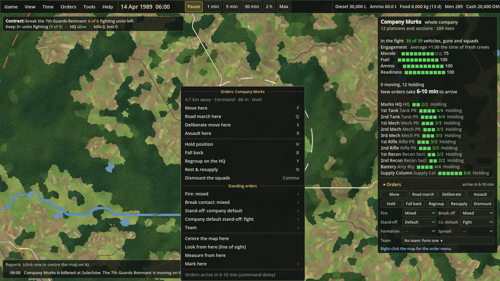

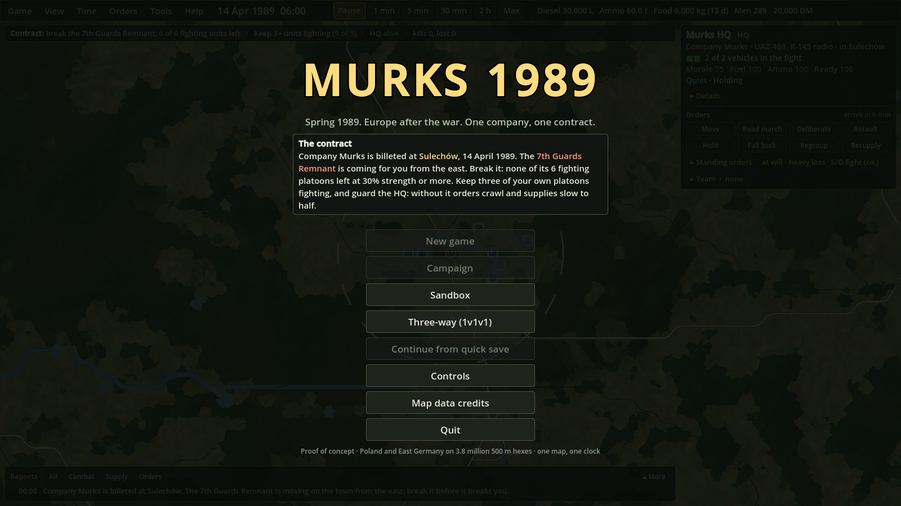


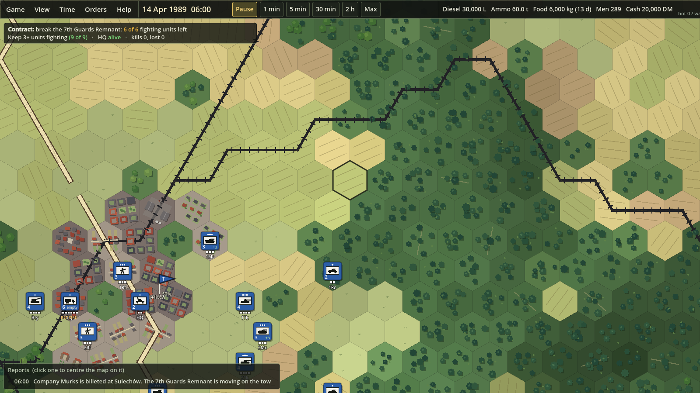

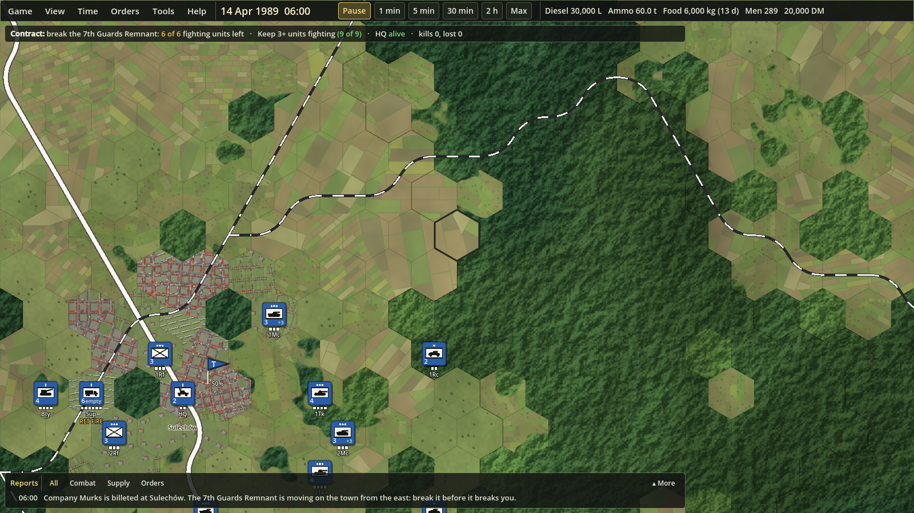

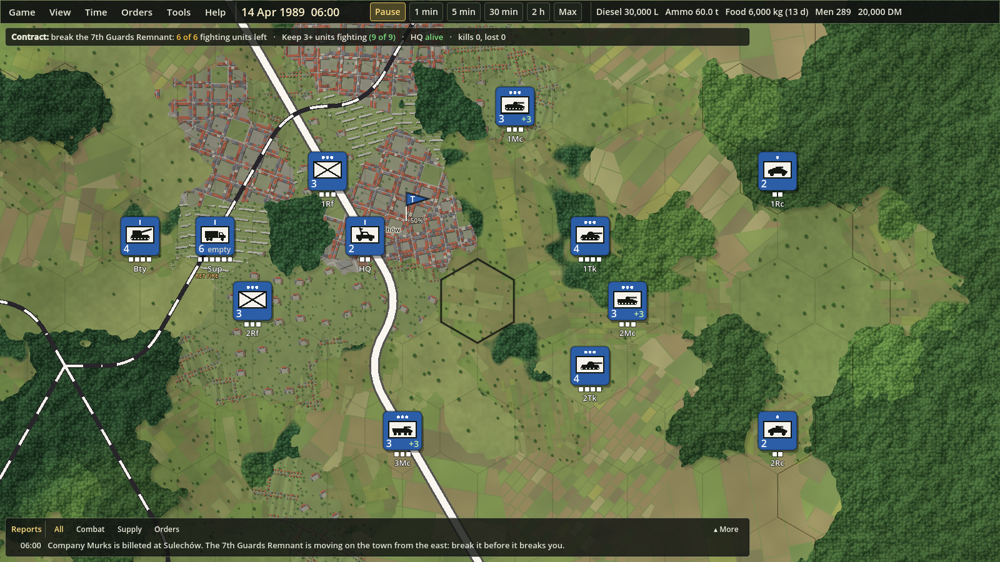

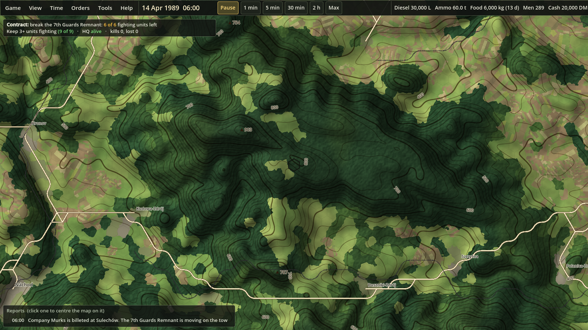

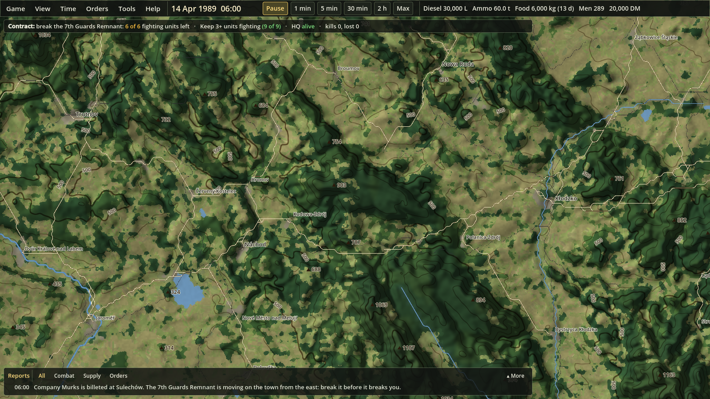

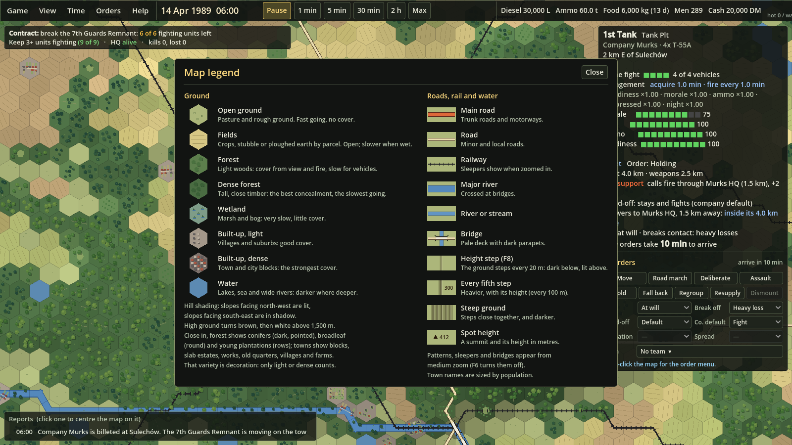

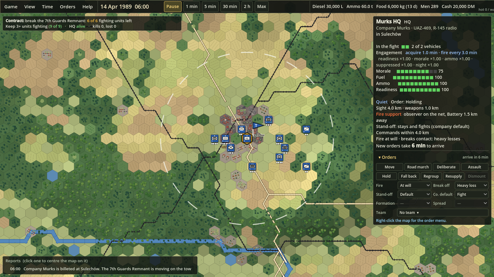

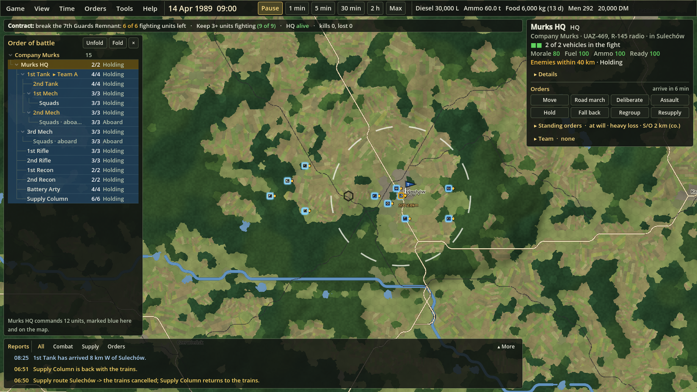

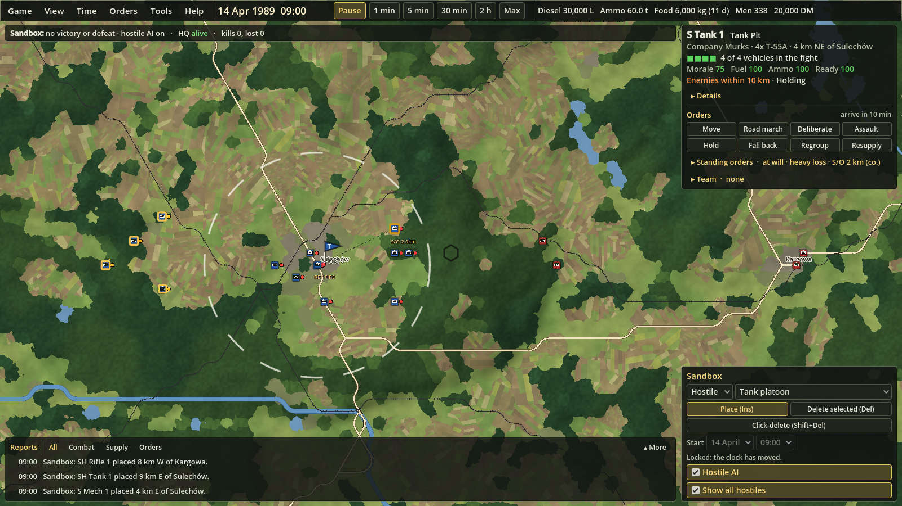

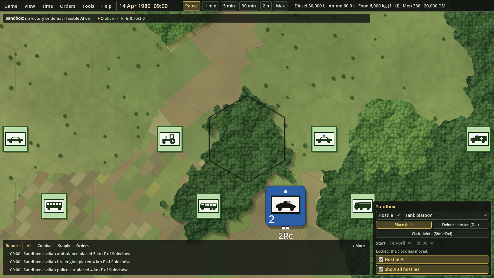

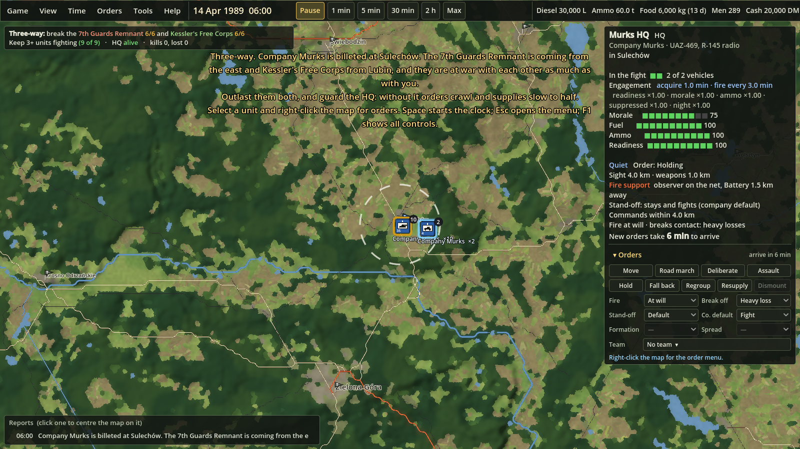

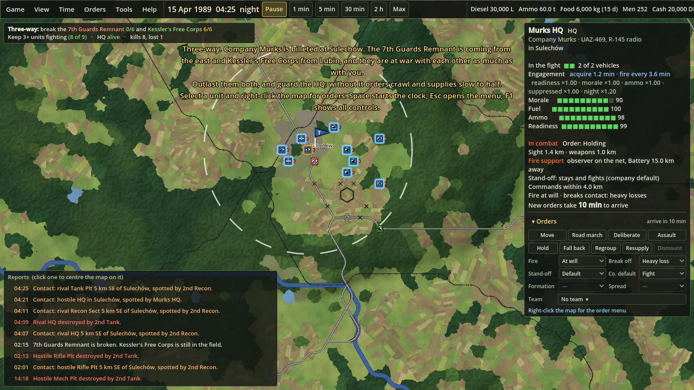

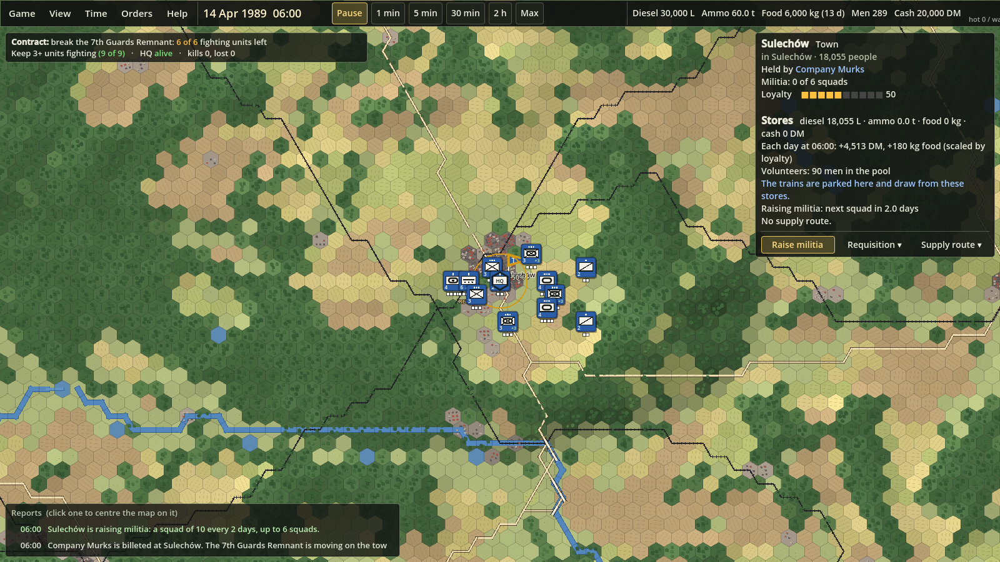

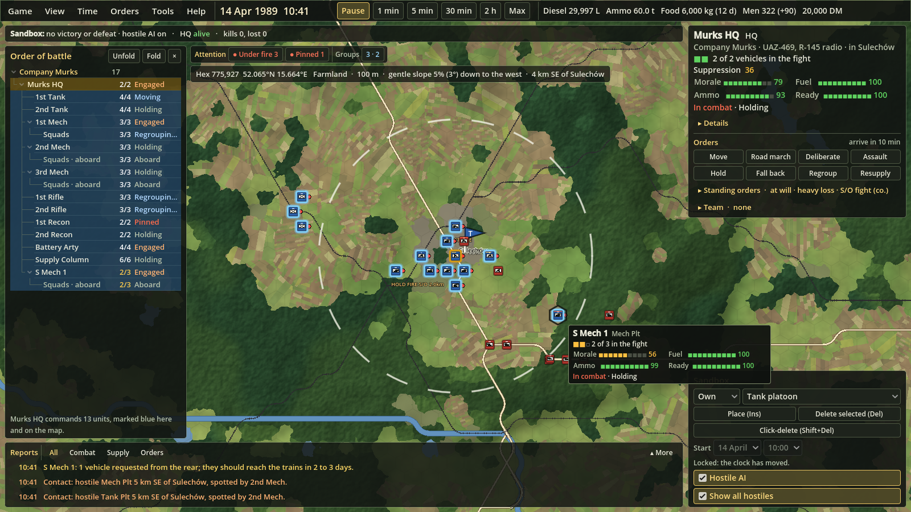

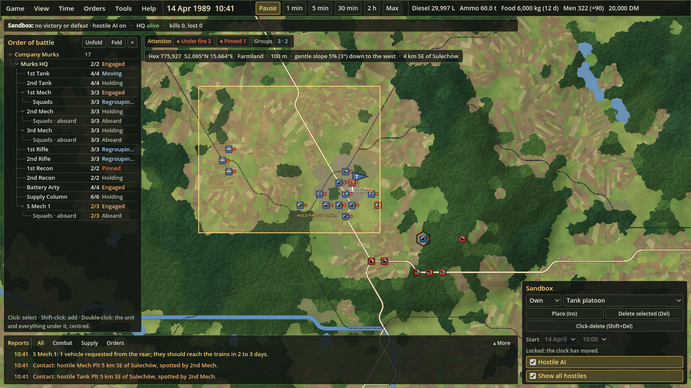

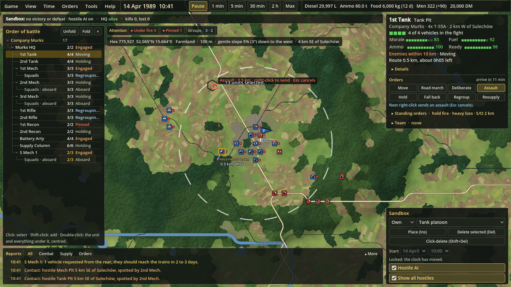


## Run it (Windows)

1. Install **Godot 4.5 or newer** (built and tested with 4.7.2): https://godotengine.org/download
2. Open Godot, choose **Import**, and select `game/project.godot`.
3. Press **F5** (Run Project). The map loads in under a second.

The prebuilt extension is in `game/bin/` (`libmurks.windows.template_debug.x86_64.dll`, plus a Linux `.so`), so no compiler is needed just to play.

### Controls

| Input | Action |
| --- | --- |
| Left click | Select unit (Shift adds to the selection). On the theater map, clicking a company counter selects the whole group |
| Double-click a unit / K | Select its whole company. The panel shows averages, men, contact status and a roster |
| Right click | Order menu for the selection at that hex (with an armed order: send it at once). A company moved together keeps its layout, with spread capped at 3 km. Orders arrive after the command delay |
| Shift+right click | Add a waypoint to the route plan for the selected unit or team (up to 16). The dashed preview shows the next leg and its time |
| Enter | Send the route plan as one order |
| Backspace | Drop the last waypoint of the plan |
| Esc | Close a dialog; drop the route plan; cancel an armed order; otherwise open or close the pause menu |
| Left drag | Selection box: selects every own unit inside (Shift adds to the selection) |
| Middle drag, WASD / arrows | Pan |
| Mouse wheel | Zoom |
| Space | Pause / resume |
| − / + | Slower / faster: pause, 1 min/s, 5 min/s, 30 min/s, 2 h/s, max |
| Ctrl+1–9 / 1–9 | Store the selection as control group N / select it (press twice to centre on it) |
| . (period) | Step 15 minutes while paused |
| H | Hold position |
| Tab / C | Next unit / centre on the selection |
| M | Whole map |
| O | Company grouping on or off. When on, it applies automatically once hexes are smaller than 14 px on screen |
| F / Q / E / R | Arm the next right-click: move (hasty) / road march / deliberate / assault, sent at once without the menu. After the order the right-click opens the menu again |
| B / Y / N | Fall back / regroup on the company HQ / rest & resupply at the HQ (or on whoever took over from it) |
| X | Cycle fire: at will, return fire, hold fire |
| G / V / Z | Hex grid / line of sight of the selected unit / fidelity zones |
| P | WeGo pulse: pause each time the HQ can issue orders |
| U | Auto-pause on contacts and losses |
| F1 | Show / hide the controls dialog |
| F2 | Map data credits |
| F4 | Map legend |
| F6 | Painted terrain textures on / off (off: one flat colour per terrain) |
| F7 | Counters show vehicles / NATO symbols |
| F8 | Topographic map: contour lines and heights on / off |
| F10 | Planning map: steps through going (tracked, wheeled, foot), cover, slope, line of sight, off |
| F11 | Order of battle panel on / off. Click a row: select that unit; Shift-click: add it; double-click: the unit and everything under it, centred; click the company line: the whole company |
| Ins / Del / Shift+Del | Sandbox only (sides Own, Hostile or Civilian): Place tool on / off; delete the selection; click-to-delete on / off (Esc ends a tool) |
| F12 | Civilians on / off (display only) |
| Ctrl+drag / Shift+R | Ruler: distance, grid bearing, travel time and elevation profile (Shift+R: click the start, then the end) |
| Shift+G | 1 km map grid; the status bar adds the grid reference |
| Shift+O / P / T / N | Mark an objective / phase line (click its points, right-click or Enter to finish) / target reference point / note. Right-click a marking to rename or delete it |
| F5 / F9 | Quick save / quick load (one slot, in Godot's user folder) |
| J / Shift+J | Form a team from the selection / disband the selection's teams |
| L | Select the team of the selected unit (double-click does the same) |
| Shift+L | Rejoin team: a member that left its formation on its own orders takes its place again |
| , (comma) | Dismount the squads of the selected APC/IFV platoons, or mount them up again |
| Click a pennant | Select a holding: its panel shows stores, loyalty, militia and routes, with Raise militia, Requisition and Supply route |
| F3 | Supply overlay: routes and convoys |
| T | Direct command overlay: every unit outlined and linked to its commander, with zones |
| I | Fire support overlay: the fire net, range rings, relays, units cut off, fire missions |

**Try this:** press Tab until **1st Recon** is selected, right-click about 30 km east, press 4 and watch. When the hostile strike group is spotted, the game pauses and the fight starts on the same map.

**Time compression.** The 30 min/s, 2 h/s and Max speeds drop to 5 min/s while the company is in contact: an own unit fired, was fired at or was hit in the last 15 minutes, or a hostile is in sight within 5 km. Fast-forward also stops on the minute anything pause-worthy happens, so Max never runs past a contact.

### What the orders do

| Order | Effect in the simulation |
| --- | --- |
| Move (hasty) | Normal speed. Fires on the move at 75% accuracy |
| Road march | Routes keep to roads wherever they can, and road steps are 15% faster. Off-road legs (to reach the road, or the last stretch) move at the normal rate. Fires at 50% on the move, and is 30% easier to hit while marching. When no road is left on its route, or once an enemy is known within 5 km, the column deploys into a normal move, and it leaves road march when it arrives |
| Deliberate | 1.5× slower. Stays concealed in forest and towns while moving and shoots as if halted |
| Assault | 1.15× slower. Fires at 85% on the move. Break-contact thresholds drop by 40% while advancing |
| Fall back | Withdraws about 6 km directly away from the nearest enemy seen in the last hour, or back to the HQ if none |
| Regroup | Forms up within 2 hexes of the company HQ (or where the HQ is heading); with the HQ lost, on the platoon that took over from it |
| Rest & resupply | Regroups, then rests: fuel and ammo refill at 50 points an hour instead of 25, and morale and readiness recover twice as fast |
| Fire: return fire | Shoots only within 5 minutes of being fired at. Firing gives a unit away, so this keeps scouts hidden |
| Fire: hold fire | Never shoots |
| Break contact | When the unit falls back on its own: below 30% strength or morale 25 (heavy losses), below 60% or morale 45 (light losses), or only when morale drops under 8 (never) |

## Measured performance

Measured in a 2-core cloud Linux VM. Your PC will be faster.

| What | Result |
| --- | --- |
| Loading the real map (3.8 M hexes, 4,687 towns; 6.8 MB compressed) | ~0.4 s at startup |
| Baking the real map from scratch (downloads included) | ~1-2 min; re-bakes from cache ~45 s |
| Procedural map generation (2.2 M hexes) | ~2.6 s at startup |
| Map memory | 30.3 MB real map, 17.3 MB procedural (8 bytes per hex) |
| Chunk mesh build (roads, rivers, railways of 4,096 hexes) | ~0.4 ms average, 1.2 ms worst in C++ |
| Ground | One shader pass over the screen; no per-chunk geometry. Not yet measured on a real graphics card |
| Worst single frame while panning 720 km at chunk zoom | ~7 ms of chunk building |
| Simulation, 212 units | ~0.2–0.5 ms per game minute (2 days in 0.85 s) |
| Simulation, 499 units (`--groups=60`) | ~0.8 ms per game minute |
| GDScript per frame (overlay drawing + glue) | ~0.5–1 ms |

Scaled up, the full Atlantic-to-Urals map (about 47 M hexes) needs about 380 MB of hex data. That is why chunks are stored contiguously, so they can be paged from disk.

## The real map

`game/data/poland_1989.murkz` covers longitude 10–24.2°E and latitude 49–55°N (East and West Germany's border region, Poland, Bohemia, Kaliningrad and the edges of the Baltic states, Belarus and Ukraine). It is projected on EPSG:3035 (Lambert Azimuthal Equal Area), so grid north is true north only along 10°E. The status bar shows the latitude and longitude under the cursor.

How it is built (`tools/bake_region.py`):

1. Build a 125 m raster in EPSG:3035, aligned with the hex grid.
2. **Elevation.** Warp the Copernicus GLO-90 tiles into it. They are read in place from AWS.
3. **Land cover.** Do the same with ESA WorldCover, read from its built-in 1/8 overviews, so each 3° tile is a few MB.
4. **Terrain per hex.** Average about 14 samples per 500 m hex. Elevation is the mean. The terrain type comes from land-cover shares: water, built-up, forest, marsh, farmland, otherwise open. Partial tree cover adds some line-of-sight cover.
5. **Networks.** Trace Natural Earth rivers, main roads and railways through the hexes. Each network is stored per hex edge, and zigzags are removed.
6. **Towns.** Place GeoNames towns of 2,000+ people, with 1989 names where they differed (Karl-Marx-Stadt, Lvov, Grodno).
7. **Finish.** `finish_map` (C++) adds A*-routed local roads between towns that join the real network. The result is then compressed.

To re-bake it, or bake another region:

```
pip install numpy rasterio pyproj shapely pyogrio pillow
cmake -B build -DCMAKE_BUILD_TYPE=Release && cmake --build build --config Release
python tools/bake_region.py --bbox 10 49 24.2 55 --out game/data/poland_1989.murkz --finish-map build/finish_map
```

**Relief for the topographic mode (work board MRK-23).** `tools/bake_contours.py` reads the same Copernicus GLO-90 tiles, warps them onto a 90 m raster in the map's frame and smooths out single-pixel noise (the data is a surface model, so woods and towns add bumps). It writes `game/data/poland_1989.murkc` (12.5 MB): a height raster at 180 m (5,869 x 4,314, whole metres), a height figure for every 100 m contour at least 3 km long (13,700), and spot heights (4,400: the highest point within 5 km that stands at least 40 m above the lowest ground around it, up to six per chunk). The game loads it with the map; without it the topographic mode is simply not offered. It is drawing data only: the simulation still uses the per-hex heights.

```
pip install contourpy scipy
python tools/bake_contours.py --bbox 10 49 24.2 55 --out game/data/poland_1989.murkc
```

**F8** (View > Topographic map) prints contour lines into the painted ground: the terrain shader draws them from the height raster as a darker, browner tone of whatever lies beneath (forest, field or town), about a pixel wide, so they read as part of the ground rather than a sheet laid over it. They are every 20 m from 20 px per hex with every 100 m line heavier, every 100 m further out (500 m heavier) and every 500 m on the whole-map view; lines that would crowd closer than a few pixels fade out, the heavy ones last. Lines close together mean steep ground, and the hill shading shows which way slopes face. The 100 m lines carry their height (500 m further out) and summits are marked with a triangle and their height in metres; figures that would crowd each other are left out. The status bar and the order menu title give the slope of the hex under the cursor in every mode ("steep slope 18% (10°) down to the south-east"), from the per-hex heights the simulation uses. Slope slows movement (see **Slope** above).

**Planning map (work board MRK-25).** View > Planning map, **F10** (steps through) or the mode panel shows the ground the way a commander plans on it: a tint per hex over the painted terrain (a little greyer underneath), crisp per hex because the rules are per hex, with a colour key next to the reports. Every figure comes from the functions the rules use, so the map shows what the simulation does (`core/src/planning.cpp`, checked by `tests/planning_test.cpp`):

- **Going: tracked, wheeled, on foot.** Minutes to cross each hex off-road at full readiness: the mean of the pathfinder's own step cost (`World::step_minutes`, which `move_cost` now calls) into it from each land neighbour, with terrain, river crossings and slope. Shown against open ground for that mobility (faster, as good, up to 1.6x, 2.6x, 5x slower, slower still, impassable); the key gives km/h per band and the road speeds.
- **Cover and concealment.** The hit factor from fire for vehicles and infantry (`terrain_cover_factor`) and whether a unit sitting still is hidden (found only within 1 km, 2 km by recon); darker where cover is 20 m or taller, which also blocks sight.
- **Slope.** The five slope classes from the per-hex heights, the same as the status-bar readout. The key gives what each class does to an off-road climb (tracked, wheeled, on foot) from the movement rule itself.
- **Line of sight from a point.** Right-click > Look from here (or the selected unit, or the HQ): every hex within 12 km lit if a 2.5 m target there can be seen, darkened if it is dead ground, by `World::line_of_sight` as the spotting model uses it. Eye height 2 m (on foot), 3 m (vehicle, as the rules), 10 m (rooftop) or 30 m (mast or tower); the panel says how much is seen.

The status bar adds the mode's figure for the hex under the cursor (going in km/h, cover factors, seen or dead ground). Sight (V) and Zones (Z) stay separate toggles: they are outlines and combine with a planning mode. A whole-map mode is worked out once when chosen (about 0.2 s on the Poland map). Drawing only: the sim refactor behind it keeps the arithmetic, so results and saves are unchanged.

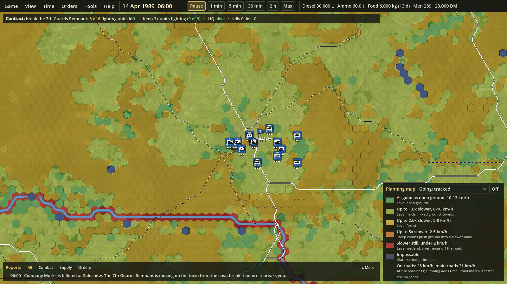

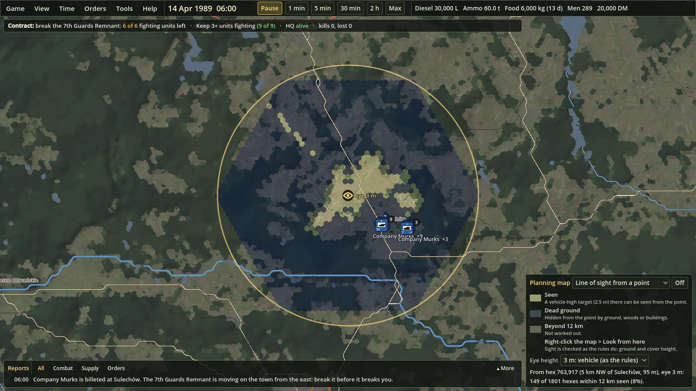

**Planning tools (work board MRK-26).** The Tools menu, the right-click map menu and a few keys:

- **Ruler.** Ctrl+drag on the map, Shift+R (click the start, then the end) or right-click > Measure from here. The panel gives the straight distance, the grid bearing in degrees and NATO mils (6400 to the circle), and the grid reference of both ends. Below that, the travel time for tracked, wheeled and foot units at the chosen move mode, at full readiness: the best route found the way orders find routes (the same step costs and A* search; hexes held by the enemy are ignored), so a unit ordered there takes that route and time (checked in `tests/planning_test.cpp`). A tired unit is up to 40% slower. The selected unit's kind of route is drawn dotted; click a row to show another.
- **Elevation profile.** In the same panel, from the per-hex heights and cover the rules use: along the straight line, with the line of sight from its start to its end (eye height as the planning map's, target 2.5 m) and the hex that blocks it, or along the route shown. Climb, descent and the steepest grade between hexes; the chart gives height and cover under the mouse. Tools > Elevation profile of the selected unit's route does the same for a unit on the move.
- **1 km grid** (Shift+G, View or Tools menu): squares on the map's own projected metres (EPSG:3035 on the baked map), heavier every 10 and 100 km, 10 km or 100 km squares when zoomed out, numbered along the top and left. The status bar adds the grid reference to 100 m: the 100 km square, then three figures of easting and three of northing ("GR 47/32 214 683"). Bearings are grid bearings.
- **Markings**: objectives (Shift+O), phase lines (Shift+P), target reference points (Shift+T, numbered TRP 01, 02, ...) and notes (Shift+N), or right-click > Mark here. Drawn in black with a white halo like control measures on a map overlay. Right-click one to rename or delete it; Tools > Clear all markings. They are saved with the game (save format v9 and later; older saves are refused) but are the player's own notes: orders and the simulation do not read them.

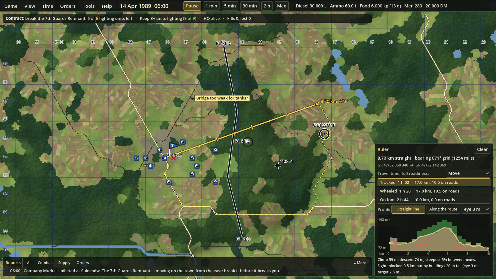

On Windows the `--finish-map` path is `build\Release\finish_map.exe`. The first run reads several hundred MB of source data and caches the processed tiles in `~/murks_cache`.

Not yet corrected to 1989:

- Borders. There is no inner-German border yet.
- Motorways built after 1989. Natural Earth shows today's network.
- Closed railway lines.

That is the hand-made "1989 correction layer" from the design plan.

### Map data credits

The same text is in the game (F2):

- **Elevation:** Copernicus DEM GLO-90, © DLR e.V. 2010-2014 and © Airbus Defence and Space GmbH 2014-2018, provided under COPERNICUS by the European Union and ESA; all rights reserved.
- **Land cover:** © ESA WorldCover project 2021 / Contains modified Copernicus Sentinel data (2021) processed by ESA WorldCover consortium. CC BY 4.0.
- **Rivers, roads, railways:** Made with Natural Earth (public domain).
- **Place names and populations:** GeoNames (geonames.org), CC BY 4.0.

## Layout

```
core/         Pure C++17 simulation (no Godot code): hex maths, map (+ file format), generator, A*, sim, render data, geo, planning map
extension/    GDExtension binding: one class, MurksWorld, with coarse calls (whole chunks, snapshots, many ticks)
game/         Godot project: scripts/main.gd (input, clock), map_view.gd (ground and line streaming), overlay.gd (symbols), hud.gd; shaders/terrain.gdshader (the painted ground)
game/data/    Baked real map (.murkz = zlib-compressed MURKSMAP)
tools/        bake_region.py (real-data pipeline), finish_map.cpp (adds local roads), bake_contours.py (height raster, height figures and spot heights for the topographic mode)
tests/        core_bench.cpp: headless run of map + sim with timings; hq_loss_test.cpp: checks the HQ-loss rules; rules_test.cpp: checks the Historical Values rules; fire_support_test.cpp: checks gun ranges and the fire support net; dismount_test.cpp: checks mounted infantry; suppression_test.cpp: checks suppression; team_detach_test.cpp: checks detaching and rejoining team members; route_test.cpp: checks waypoint routes and route edits; sandbox_test.cpp: checks the sandbox (placing, removing, start time, hostile AI off, no outcome, save/load); three_way_test.cpp: checks the three-way scenario (setup, hostiles and rivals fighting each other, kills and reports, hunters' targets, holdings, outcome, save/load and replay); civilians_test.cpp: checks civilians (traffic, services, danger, congestion, no damage, separate dice, save/load); holdings_test.cpp: checks holdings, capture, loyalty, requisition, militia, supply routes and convoys; planning_test.cpp: checks the planning map and tools against the rules (going against move_cost, line of sight against the spotting model, tints and keys, the ruler's route and time against a unit ordered there, the profile's sight line, grid references, markings through save/load); attrition_test.cpp: kill-rate harness (`attrition_test calibrate`); playtest.cpp: real-map 4-day scripted runs over many seeds (`playtest game/data/poland_1989.murkz 4 active 1989 12`, add `three-way` for the 1v1v1, needs zlib; set MURKS_NO_CIVILIANS=1 to run without civilians); render_shot.cpp: draws flat-coloured hexes with the road, river and rail meshes to an image without Godot and times the chunk builds (`render_shot game/data/poland_1989.murkz shot.ppm 470 860 40`, or `... bench`, needs zlib)
SConstruct    Builds the extension into game/bin/
CMakeLists.txt  Builds the core, benchmark and finish_map on their own (handy in Visual Studio)
```

## Rebuild the C++ (Windows)

You only need this to change the C++ code.

1. Install **Python 3**, then run `pip install scons`.
2. Install **Visual Studio 2022 Build Tools** with the "Desktop development with C++" workload.
3. From the repository root, fetch the Godot bindings (once):
   ```
   git clone --depth 1 --branch godot-4.5-stable https://github.com/godotengine/godot-cpp.git godot-cpp
   ```
4. Open **"x64 Native Tools Command Prompt for VS 2022"**, `cd` into the repository and run:
   ```
   scons                          (debug build, used by the editor; the first build takes 10-20 min)
   scons target=template_release  (release build, needed for exported games)
   ```
5. Restart the Godot editor, or let it hot-reload the extension.

The core has no Godot dependency, so you can also open the folder in Visual Studio (CMake) and run `core_bench` to test simulation changes in seconds (`hq_loss_test`, `rules_test`, `fire_support_test`, `dismount_test`, `suppression_test`, `route_test`, `slope_test`, `replacements_test` and `wages_test` and `reinforcements_test` check the rules and exit non-zero on a failure; `attrition_test calibrate` checks the kill rate is inside the historical band).

On Linux, the same `scons` works. To cross-compile Windows from Linux, use `scons platform=windows use_mingw=yes`.

## Command-line options

Pass these after `--` when launching Godot:

- `--groups=N`: number of hostile bands (default 24, about 212 units). Use 60 or more as a stress test.
- `--procedural`: ignore the baked map and generate a fictional one.
- `--three-way`: set up the three-way (1v1v1) scenario instead of the contract. With `--autotest=DIR` it saves the briefing and then runs the clock (the company holding at home) until both the 7th Guards and the Free Corps are in sight at once, or three days pass, and shoots the theater view there (`47_three_way_start`, `48_three_way_contact`, `49_three_way_theater`).
- `--autotest=DIR`: scripted run that saves screenshots and timing to `DIR`, then quits.
- `--views=DIR`: renders seven fixed map views without the HUD to `DIR` (hills south of Wrocław at 10, 30 and 80 px per hex, the home area at 25 and 70, a town at 150, the region at 3), prints the average colour of each painted material, then quits; about 15 seconds. Add `--crisp`, `--flat` or `--topo` for crisp hex borders, flat colours or the topographic mode, or `--plan=N` for a planning mode (1-3 going, 4 cover, 5 slope, 6 line of sight from the best observation post near home; `--eye=0..3` picks the eye height), or `--tools` for the 1 km grid, a ruler from home with its panel, and sample markings. The quick check after a change to the terrain shader.
- `--uitest`: scripted check of the menus (title screen, right-click menu, armed orders, Esc and the pause menu, dropdowns, View and Orders menus, the painted ground (shader, textures on and off, natural or crisp edges, grid by zoom), the map legend, counter size and vehicles, the topographic mode, the planning map (menu, F10, panel, going tint, status bar, Look from here, eye height), the planning tools (Tools menu, Shift+G grid and grid reference, Ctrl+drag ruler with its figures, travel times and profile, markings placed, renamed, saved, loaded and deleted), the holding panel, militia, a supply route and its cancellation, Requisition > Men into the replacement pool and the Replacements line, Request reinforcements on a tank platoon that lost a vehicle in a sandbox fight, the wage figures on the stock bar and its tooltip, the order of battle panel: the HQ marking everything under it, a click on a row, double-click, a team leader, F11, the sandbox: title buttons, panel, Ins and a click to place for either side, Esc, Del, Shift+Del, start time, Hostile AI box, the Three-way title button, civilians: side Civilian, a bus placed, hovered, deleted, F12, the attention strip and its chips, a click on a report, left-drag box select (Shift adds), middle-drag pan, − / + speed, Ctrl+number / number control groups, the hover card, the crosshair for an armed order; add `--uishots=DIR` for pictures 53-55): pushes real input events and menu picks, checks what reaches the simulation, prints PASS / FAIL lines and exits non-zero on a failure. Needs a window (on a Linux server: `xvfb-run godot --path game -- --uitest`).

Headless balance check (no window): `godot --headless --path game --script res://tests/playtest.gd -- 4 active` (or `passive`; add `three-way` for the 1v1v1). It plays the scenario for N days and prints contact time, losses, supplies, the outcome and a save/load replay check.

## Known limits of this proof of concept

- Map data is not yet corrected to 1989 (see above). Natural Earth has main roads only; local roads are generated.
- One scripted contract (plus the three-way scenario). No contract board yet, and wages are only a daily cost (design plan phases 3–4). Holdings, militia and supply routes refill the company stocks; levied replacements fill infantry squads; lost vehicles and guns come back only by requesting reinforcements, two to three days later (no purchases).
- Combat values follow simulated real-world performance (weapons, cover, concealment, morale), not game balance, and are not tuned to make fights even. A company defending a town against an attacker of similar size usually holds, as the attacker's rule of thumb of needing about 3:1 at the point of attack would predict.
- Pathfinding is plain A* on hexes. Very long cross-map orders cost up to ~10 ms; next comes the hierarchical road graph and the 5 km operational layer. Routes to another piece of land (islands, across the sea) are refused at once.
- One quick-save slot. A save only loads on the map it was made on.
- Exporting a game: add `*.murkz, *.murkc` to the export preset's "Filters to export non-resource files" so the map and its relief data are included.
- A fresh clone has no `game/.godot/` folder, so Godot finds neither the extension nor the script classes until the project is imported once: `godot --headless --path game --import` (or open it in the editor).
- Running `godot --import` from the command line on a project with no `.godot` folder can crash on exit with this godot-cpp/Godot pairing. Run it again and it works. Opening the project normally in the editor is not affected.
