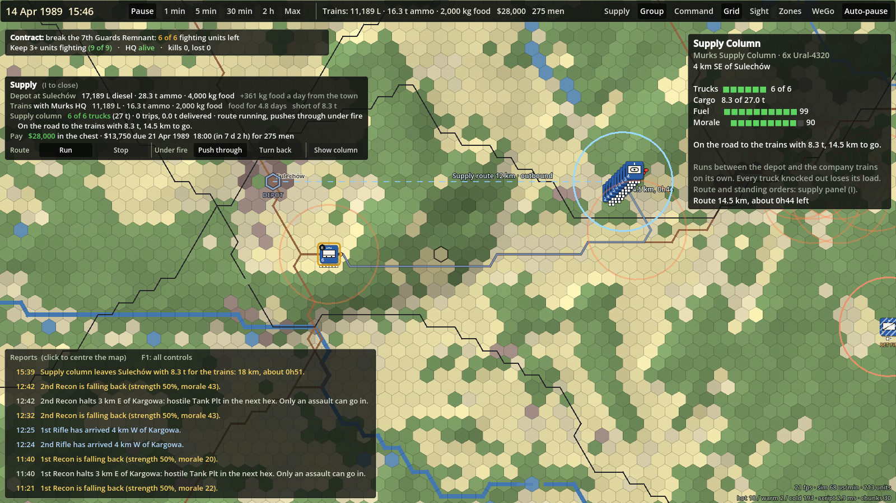
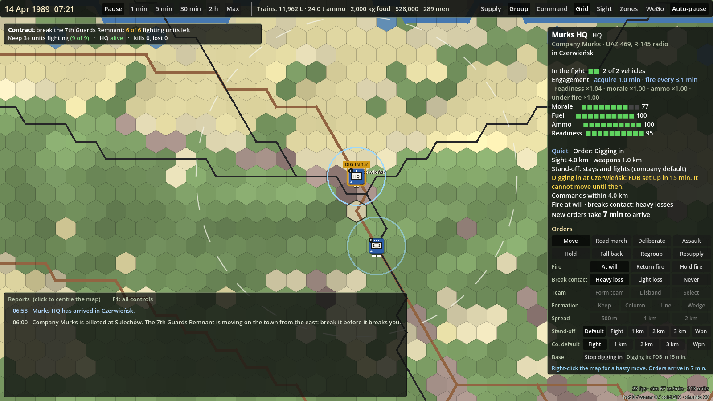
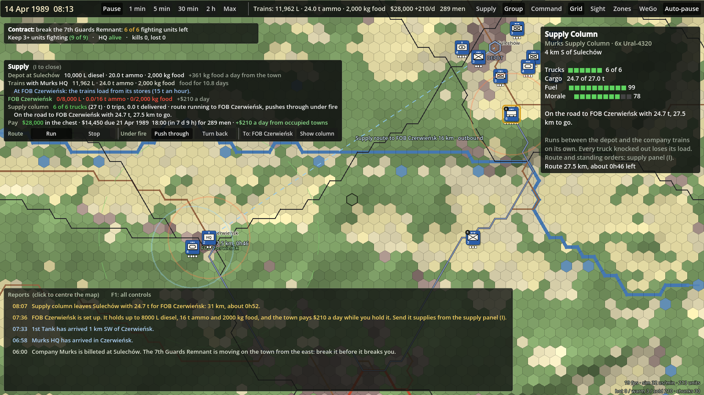

# Murks 1989 — proof of concept

A one-map mercenary wargame prototype: one continuous 500 m hex map, one pausable clock, C++ simulation core running inside Godot 4 through GDExtension.

This build proves the risky technical core of the design plan (roadmap phases 1 and 2, plus a first cut of phase 3, company and logistics):

- **One map, no battle screen.** The real Poland and East Germany, about 1,050 × 780 km in 3.8 million 500 m hexes, built from satellite elevation and land-cover data. Zooming in on a contact *is* the battle.
- **Company grouping on the theater map.** Zoomed out, each company's nearby platoons merge into one company counter. It shows the unit count, average strength and the company name. Detached platoons keep their own counter. Spotted hostile units are grouped by proximity only, because you don't know their organisation. Overlapping counters are pushed apart, with a leader line to their true position.
- **Command panel.** The selection window (one unit or a whole company) has an Orders section:
  - **Move modes.** Move, road march, deliberate or assault. The mode decides what a right-click orders.
  - **Group orders.** Hold, fall back, regroup on the HQ, and rest & resupply.
  - **Rules of engagement.** Fire at will, return fire only, or hold fire.
  - **Break contact.** At heavy losses, at light losses, or never.

  Every order and setting goes down the chain of command and arrives after the command delay. Counters show road-march, deliberate, assault and fire tags.
- **Counters and movement in the Forward Defense style.** Each unit is a square counter in its side's colour (NATO blue, hostile red) with a white NATO symbol box and echelon marks (dots for sections and platoons, a bar for a company or battery). Own counters show how many elements are in the fight bottom-left (white when all are, yellow from half, red below half), one pip under the counter per vehicle, gun or squad (hollow once knocked out), and a short name when zoomed in. They also show an order badge top-left (M move, R road march, D deliberate, A assault, F falling back, G regroup, S rest); a yellow corner flag when morale is shaken (under 45) and white hatching when broken (under 25) or falling back; and a bar along the top while under fire, red when just hit. Orders still on their way show a yellow "+12′" tag. A unit sits in the hex the simulation has it in; when it moves a hex the counter glides there in a quarter second. Counters grow to fill the hex when zoomed in, units sharing a hex fan out diagonally inside it, and each can be clicked. Last-seen positions are faded with a dashed outline and "?".
- **Combat effectiveness (binary per element).** Every unit is made of elements: vehicles, guns or squads ("4x T-55A" is 4 tanks, "35 men" is 3 squads; types without a count use 3 tanks or vehicles, 2 recon vehicles, 4 guns, 2 HQ vehicles). Each element is either in the fight or knocked out. Hits are resolved as whole elements: the fire weight of a hit (firepower × 0.6–1.4, × anti-armour against armour, × the share of the shooter's elements still fighting) is a 1-in-(100 ÷ elements) chance per point of knocking out one element, which keeps the average loss per hit what it was before. Strength is 100 × elements ÷ full complement, so the break-contact and victory rules still read it.
- **Engagement time.** Crew condition no longer changes hit chance; it changes how long a unit takes to acquire a new target (1 minute direct fire, 4 minutes to plot a fire mission) and to work through each fire cycle (the type's fire interval: 3 minutes, guns 8). Both are multiplied by readiness (1 + (100 − readiness) ÷ 100), morale (1 + (60 − morale) ÷ 60 below 60), ammo (up to × 2 below a quarter load) and being under fire in the last 5 minutes (× 1.3). The unit panel shows "acquire 1.3 min · fire every 3.8 min" and each factor. These factor values are first estimates in `World::engagement_time` (`core/src/sim.cpp`), to be replaced with historical data.
- **Teams, command zones and formations.** Select two or more of your units and press J (or Form team in the Orders panel) to lock them under one leader: the company HQ if it is in the selection, otherwise the first unit you selected (a platoon commander). Each team gets a colour (Team A amber, B teal, C purple, ...): its counters wear a frame in that colour and the leader carries a pennant.
  - **Zone of command.** An HQ commands effectively within 4 km, a team leader within 2 km. Team members take orders through their leader (one more step in the chain: +3 minutes), everyone else through the company HQ. A unit outside its commander's zone gets orders 1.5 times slower; beyond radio range (20 km) a courier carries them, as before. The rule applies to both sides. The Command toggle (T) shows every zone as a dashed ring with dashed lines from each unit to its commander; otherwise they show for the selection. The unit panel says who a unit answers to, how far away, and whether it is inside the zone.
  - **Formations.** A team keeps one of four formations around its leader: Keep (the layout it had when formed or when Keep was pressed), Column, Line or Wedge, facing the direction of travel, with 500 m, 1 km or 2 km between places. Right-click with the leader selected moves the whole team: the order goes to the leader through the command delay, and the members keep station on it, re-taking their places as it moves. The team moves at the pace of its slowest member: the leader halts while anyone who can move is more than 1.5 km out of place. Hold with the leader selected halts the team, which forms up on the leader. A member given its own order leaves the formation (thin frame) until the next team order. If the leader is destroyed, the next unit (an HQ first) takes command.
  - **Selecting.** Double-click a team member (or press L) for its whole team; K for the whole company. On the theater map each team gets its own counter.
  - **Formation pathfinding rules.** (1) Column: members follow the leader's own track, each rank (spacing × rank) hexes behind, and queue along it when the leader halts. (2) Line, wedge and keep: each member takes its place around the leader's present hex, laid out along the leader's route a few hexes ahead (so the formation wheels with the road), and re-takes it whenever the place has moved 1 km; re-routing keeps the progress already made into the next hex. (3) If a member's place is water, cut off or held by the enemy, it files in on the leader's track instead (the formation closes up, e.g. onto a bridge). (4) Defiles: if a member's own route to its place would take more than twice as long as the leader's going (a river without a bridge, marsh, deep forest beside the road), it files in on the leader's track and opens out again once past. (5) The team keeps its slowest member's pace: the leader halts while anyone who can move is more than 3 + spacing ÷ 2 hexes from its place. On a 50 km road route a column team took about a third longer than its leader alone, mostly forming up.
- **Enemy-held hexes.** Only a unit on an assault order may move into a hex the enemy holds. Anyone else halts in the hex before it, and both sides now know about each other ("1st Tank halts ...: hostile Tank Plt in the next hex. Only an assault can go in."). Routes avoid hexes held by enemies the side knows about (seen now or in the last 30 minutes), except the destination itself, so an order onto an enemy brings the unit up to it. Applies to both sides.
- **Stand-off.** Each unit can stay and fight or keep known enemies at a distance: 1, 2 or 3 km, or its own weapon range. With a stand-off, a unit on the move halts before closing inside it, and a unit an enemy comes closer to pulls back out to it (checked every 5 minutes). It is a standing order: the per-unit setting travels down the chain like fire orders, and "Default" follows the company default, which the player sets in the Orders panel and which applies at once. An assault ignores stand-off; team members go by their leader's. Counters show "S/O 2.0km" and the unit panel says what the unit does. The company default starts at "stay and fight".
- **Map marks.** Selected units show their route in blue with an arrowhead and arrival time, a dashed arrow and yellow tag for an order still travelling ("Road march +35′"), and a dashed line to their company HQ. Shots in sight draw a tracer and an impact flash, artillery a muzzle flash and a spread of bursts, fire from shooters you can't see shows as incoming bursts on your unit, and a destroyed unit explodes and leaves a wreck mark. The hex under the mouse is outlined. These are display only; they don't change any simulation result.
- **Streaming.** Far out you see a one-pixel-per-hex overview; closer in, 64 × 64-hex chunk meshes are built in C++ and streamed in and out as the camera moves.
- **One clock.** A fixed one-minute tick, pause, five speeds, auto-pause on contact, a speed cap while units are in contact, and an optional WeGo pulse.
- **Command friction.** Orders take 5–30+ minutes to reach units, longer out of radio range, in combat, or when tired.
- **Flashpoint-style combat.** Line of sight from elevation and cover, concealment in forests and towns, night spotting, fog of war with last-known positions, direct and indirect fire, morale, and standing orders that make hurt units fall back.
- **Simulation fidelity zones.** Hot (within 10 km of an enemy), warm (10–40 km) and cold zones.
- **The supply line (phase 3, first cut).** The company's stocks are split between the **trains** that travel with the HQ (a few days' worth: 12,000 L diesel, 24 t ammo, 2,000 kg food) and the **depot** at the home town (18,000 L, 36 t, 4,000 kg, the same totals as before). The town's market sells the depot food every morning. Units halted near the depot draw from it; units halted near the HQ draw from the trains (at half rate from whoever took over a lost HQ). The trains reload at the depot themselves, 15 t an hour. Away from it, the **supply column** brings them what they are short of: six Ural-4320 trucks (27 t), a real unit on the map that loads at the depot, road-marches to the trains, unloads and drives back, burning its own diesel. It can be spotted and ambushed, and every truck knocked out loses its load. An unguarded depot is plundered by any hostile that reaches it. See "Supply line" below.
- **Forward operating bases.** An HQ in a town can dig in (Shift+H, or Dig in in the Orders panel) and turn the town into a FOB. It stays put while it digs in: 30 minutes fresh, up to an hour worn out. The FOB holds limited stores, resupplies units halted near it 1.5 times as fast and doubles their readiness recovery. It pays occupation income every morning, less for each hour hostiles spent within 5 km. The supply column can deliver to it instead of the trains. Left unguarded it is plundered, then overrun. See "Forward operating bases" below.
- **Wages and the contract's pay.** Wages of $50 a man are due every Friday at 18:00, from a chest that starts with the contract advance. Pay in full and morale rises a little; pay short and it falls, harder the second time. Breaking the strike group pays $60,000 on completion.
- **A scenario you can win or lose.** The 7th Guards Remnant hunts the company. It follows the freshest sighting any hostile has made and gets word of the company's whereabouts every six hours or so. You win by breaking it: none of its six fighting platoons left with 30% strength or more. You lose when fewer than three of your fighting units are left. Losing Murks HQ doesn't end the game, but orders then take 25 minutes longer, and after an hour's handover the senior platoon still able to fight (first in the order of battle, at 30% strength or more) takes over the company trains: units halted near it resupply at half the usual rate, and regroup and rest & resupply form up on it. If that platoon is lost or falls below 30%, the next one takes over. Hostile formations regroup the same way on whoever takes over from a lost HQ. The contract and score sit top left; an end screen offers keep playing, load, new game or quit.
- **Quick save and load** (F5 / F9). A save holds the whole simulation; loading it and playing on gives exactly the same result.

The map is baked from real data by `tools/bake_region.py` (see "The real map" below). If the baked file is missing, or you pass `--procedural`, the game generates a fictional map instead.


## Run it (Windows)

1. Install **Godot 4.5 or newer** (built and tested with 4.7.2): https://godotengine.org/download
2. Open Godot, choose **Import**, and select `game/project.godot`.
3. Press **F5** (Run Project). The map loads in under a second.

The prebuilt extension is in `game/bin/` (`libmurks.windows.template_debug.x86_64.dll`, plus a Linux `.so`), so no compiler is needed just to play.

### Controls

| Input | Action |
| --- | --- |
| Left click | Select unit (Shift adds to the selection). On the theater map, clicking a company counter selects the whole group |
| Double-click a unit / K | Select its whole company. The panel shows averages, men, contact status and a roster |
| Right click | Move the selected units to that hex. A company keeps its layout, with spread capped at 3 km. Orders arrive after the command delay |
| Left or middle drag, WASD / arrows | Pan |
| Mouse wheel | Zoom |
| Space | Pause / resume |
| 1–5 | Speed: 1 min/s, 5 min/s, 30 min/s, 2 h/s, max |
| . (period) | Step 15 minutes while paused |
| H | Hold position |
| Tab / C | Next unit / centre on the selection |
| M | Whole map |
| O | Company grouping on or off. When on, it applies automatically once hexes are smaller than 14 px on screen |
| F / Q / E / R | Right-click mode for the next order: move (hasty) / road march / deliberate / assault. After the order it goes back to move |
| B / Y / N | Fall back / regroup on the company HQ / rest & resupply at the HQ (or on whoever took over from it) |
| X | Cycle fire: at will, return fire, hold fire |
| G / V / Z | Hex grid / line of sight of the selected unit / fidelity zones |
| P | WeGo pulse: pause each time the HQ can issue orders |
| U | Auto-pause on contacts and losses |
| F1 | Show / hide all controls |
| F2 | Map data credits |
| F5 / F9 | Quick save / quick load (one slot, in Godot's user folder) |
| J / Shift+J | Form a team from the selection / disband the selection's teams |
| L | Select the team of the selected unit (double-click does the same) |
| T | Command zones and chain-of-command lines for all units |
| I | Supply panel: depot, FOBs, trains, supply column, pay. Run or stop the supply route, choose where the column delivers, and set what it does under fire. Shows the supply route and FOB territories on the map |
| Shift+H | The selected HQ digs in and sets up a FOB in the town it is in; again to stop |

**Try this:** press Tab until **1st Recon** is selected, right-click about 30 km east, press 4 and watch. When the hostile strike group is spotted, the game pauses and the fight starts on the same map.

**Time compression.** The 30 min/s, 2 h/s and Max speeds drop to 5 min/s while the company is in contact: an own unit fired, was fired at or was hit in the last 15 minutes, or a hostile is in sight within 5 km. Fast-forward also stops on the minute anything pause-worthy happens, so Max never runs past a contact.

### What the orders do

| Order | Effect in the simulation |
| --- | --- |
| Move (hasty) | Normal speed. Fires on the move at 75% accuracy |
| Road march | Routes keep to roads wherever they can, and road steps are 15% faster. Off-road legs (to reach the road, or the last stretch) move at the normal rate. Fires at 50% on the move, and is 30% easier to hit while marching. When no road is left on its route the column deploys into a normal move, and it leaves road march when it arrives |
| Deliberate | 1.5× slower. Stays concealed in forest and towns while moving and shoots as if halted |
| Assault | 1.15× slower. Fires at 85% on the move. Break-contact thresholds drop by 40% while advancing |
| Fall back | Withdraws about 6 km directly away from the nearest enemy seen in the last hour, or back to the HQ if none |
| Regroup | Forms up within 2 hexes of the company HQ (or where the HQ is heading); with the HQ lost, on the platoon that took over from it |
| Rest & resupply | Regroups, then rests: fuel and ammo refill at 50 points an hour instead of 25, and morale and readiness recover twice as fast |
| Fire: return fire | Shoots only within 5 minutes of being fired at. Firing gives a unit away, so this keeps scouts hidden |
| Fire: hold fire | Never shoots |
| Break contact | When the unit falls back on its own: below 30% strength or morale 25 (heavy losses), below 60% or morale 45 (light losses), or only when morale drops under 8 (never) |

## Supply line



The supply panel (I) shows each stock against what can carry it, days of food left, what the column is doing and the next pay day. The depot's hex is outlined in blue on the map (red for a day after it was plundered). With the panel open or the column selected, a dashed line runs from the depot to the trains.

| Rule | Value |
| --- | --- |
| Trains capacity | 12,000 L diesel, 24 t ammo, 2,000 kg food (about 5 days of food) |
| Home depot at start | 18,000 L diesel, 36 t ammo, 4,000 kg food; the town sells it 2% of its population in kg of food a day (150–1,500 kg) |
| Who draws where | Halted and out of the fight for 30 minutes: within 1.5 km of the depot from the depot, else within 1.5 km of the trains from the trains |
| Trains at the depot | Reload from it, 15 t an hour |
| Food | 1.5 kg a man a day at 06:00: units at the depot eat from it, everyone else from the trains. Short: −10 morale for those who went hungry |
| Supply column | 6 × Ural-4320, 4.5 t each, 0.4 L/km each. Takes no direct orders. Holds its fire (drivers with rifles would only give it away) and breaks contact early, like an HQ (under 60% strength or morale 45) |
| When it sets off | The trains are more than 1.5 km from the depot and short of at least a quarter of a load (7 t with six trucks), or of half of any one stock |
| A trip | 30 min loading, road march to the trains (re-routed every 15 min if they move on, or when it is halted), 30 min unloading, drive back. It refills its own tanks from the depot |
| Ambush | Each truck knocked out takes its share of the cargo. Under fire it pushes through (default) or turns back (supply panel) |
| Enemy at the depot | With known enemies within 3 km of the depot, a parked or loading column drives out with what is aboard (towards the trains if they are away, else away from the enemy) and waits. It does not drive back while they are there |
| Raids | A hostile within 1 km of the depot, with no own unit (other than the column) within 2 km, carries off 25% of every store each hour. Locals report it; only the first report of a raid pauses the game |
| Wages | $50 a man a week, every Friday at 18:00 from 21 April. Paid: +3 morale. Short: up to −15 morale (× 1.5 from the second time) |
| Money | Chest at start: $8,000 of the company's own plus the $20,000 contract advance. Completion: $60,000 |

These are first estimates (constants at the top of `core/include/murks/sim.hpp`, logic in `update_logistics` and `update_convoy` in `core/src/sim.cpp`), to be replaced with historical data like the combat values.

## Forward operating bases





Take a town by putting your HQ in it and digging in. The HQ can't move while it digs in, so keep it out of the fight, and leave a platoon to hold the town afterwards. The counter shows "DIG IN 34′" and an E badge. A FOB has a green hex outline on the map, and with the supply panel open its 5 km territory is drawn as a dashed ring.

| Rule | Value |
| --- | --- |
| Who and where | An own HQ inside a town's built-up area. Not the home town (already the depot), one FOB per town |
| Digging in | The order goes through the command delay. Then 30 min at full readiness, up to 60 min worn out (30 + 30 × (100 − readiness) ÷ 100). The HQ takes no move, hold, fall-back or regroup orders meanwhile; Dig in again stops it |
| Broken off | A hit on the HQ, or breaking contact on its standing orders, abandons the dig-in |
| Stores | Up to 8,000 L diesel, 16 t ammo, 2,000 kg food. Empty when set up; stocked by the supply column (supply panel, "To:") |
| Resupply | Units halted within 1.5 km draw from the FOB at 1.5 × the usual rate (37.5 points an hour, 75 resting); the trains reload there at 15 t an hour |
| Rest | Readiness recovers twice as fast at a FOB |
| Food | Units at a FOB eat from its stores |
| Income | $0.05 a resident a day ($100–$4,000), paid at 06:00. Each hour of the past day that a hostile spent within 5 km of the FOB costs 1/24 of it |
| Raids | Unguarded (no own unit but the column within 2 km) with a hostile within 1 km: plundered 25% of every store, with a warning. Still unguarded at the next hour: overrun and lost with its stores; the column goes back to serving the trains |

First estimates again, in `core/include/murks/sim.hpp` (`DIG_IN_*`, `FOB_*`) and `update_dig_in`, `fob_income`, `raid_depots` in `core/src/sim.cpp`.

## Measured performance

Measured in a 2-core cloud Linux VM. Your PC will be faster.

| What | Result |
| --- | --- |
| Loading the real map (3.8 M hexes, 4,687 towns; 6.8 MB compressed) | ~0.4 s at startup |
| Baking the real map from scratch (downloads included) | ~1-2 min; re-bakes from cache ~45 s |
| Procedural map generation (2.2 M hexes) | ~2.6 s at startup |
| Map memory | 30.3 MB real map, 17.3 MB procedural (8 bytes per hex) |
| Chunk mesh build (4,096 hexes) | ~0.5 ms in C++ |
| Worst single frame while panning 720 km at chunk zoom | ~7 ms of chunk building |
| Simulation, 212 units | ~0.2–0.5 ms per game minute (2 days in 0.85 s) |
| Simulation, 499 units (`--groups=60`) | ~0.8 ms per game minute |
| GDScript per frame (overlay drawing + glue) | ~0.5–1 ms |

Scaled up, the full Atlantic-to-Urals map (about 47 M hexes) needs about 380 MB of hex data. That is why chunks are stored contiguously, so they can be paged from disk.

## The real map

`game/data/poland_1989.murkz` covers longitude 10–24.2°E and latitude 49–55°N (East and West Germany's border region, Poland, Bohemia, Kaliningrad and the edges of the Baltic states, Belarus and Ukraine). It is projected on EPSG:3035 (Lambert Azimuthal Equal Area), so grid north is true north only along 10°E. The status bar shows the latitude and longitude under the cursor.

How it is built (`tools/bake_region.py`):

1. Build a 125 m raster in EPSG:3035, aligned with the hex grid.
2. **Elevation.** Warp the Copernicus GLO-90 tiles into it. They are read in place from AWS.
3. **Land cover.** Do the same with ESA WorldCover, read from its built-in 1/8 overviews, so each 3° tile is a few MB.
4. **Terrain per hex.** Average about 14 samples per 500 m hex. Elevation is the mean. The terrain type comes from land-cover shares: water, built-up, forest, marsh, farmland, otherwise open. Partial tree cover adds some line-of-sight cover.
5. **Networks.** Trace Natural Earth rivers, main roads and railways through the hexes. Each network is stored per hex edge, and zigzags are removed.
6. **Towns.** Place GeoNames towns of 2,000+ people, with 1989 names where they differed (Karl-Marx-Stadt, Lvov, Grodno).
7. **Finish.** `finish_map` (C++) adds A*-routed local roads between towns that join the real network. The result is then compressed.

To re-bake it, or bake another region:

```
pip install numpy rasterio pyproj shapely pyogrio pillow
cmake -B build -DCMAKE_BUILD_TYPE=Release && cmake --build build --config Release
python tools/bake_region.py --bbox 10 49 24.2 55 --out game/data/poland_1989.murkz --finish-map build/finish_map
```

On Windows the `--finish-map` path is `build\Release\finish_map.exe`. The first run reads several hundred MB of source data and caches the processed tiles in `~/murks_cache`.

Not yet corrected to 1989:

- Borders. There is no inner-German border yet.
- Motorways built after 1989. Natural Earth shows today's network.
- Closed railway lines.

That is the hand-made "1989 correction layer" from the design plan.

### Map data credits

The same text is in the game (F2):

- **Elevation:** Copernicus DEM GLO-90, © DLR e.V. 2010-2014 and © Airbus Defence and Space GmbH 2014-2018, provided under COPERNICUS by the European Union and ESA; all rights reserved.
- **Land cover:** © ESA WorldCover project 2021 / Contains modified Copernicus Sentinel data (2021) processed by ESA WorldCover consortium. CC BY 4.0.
- **Rivers, roads, railways:** Made with Natural Earth (public domain).
- **Place names and populations:** GeoNames (geonames.org), CC BY 4.0.

## Layout

```
core/         Pure C++17 simulation (no Godot code): hex maths, map (+ file format), generator, A*, sim, render data, geo
extension/    GDExtension binding: one class, MurksWorld, with coarse calls (whole chunks, snapshots, many ticks)
game/         Godot project: scripts/main.gd (input, clock), map_view.gd (streaming), overlay.gd (symbols), hud.gd
game/data/    Baked real map (.murkz = zlib-compressed MURKSMAP)
tools/        bake_region.py (real-data pipeline), finish_map.cpp (adds local roads)
tests/        core_bench.cpp: headless run of map + sim with timings; hq_loss_test.cpp: checks the HQ-loss rules;
              supply_test.cpp: checks the supply line (depot, trains, supply column, raids, food, wages);
              fob_test.cpp: checks forward operating bases (digging in, boosts, deliveries, income, overrun)
SConstruct    Builds the extension into game/bin/
CMakeLists.txt  Builds the core, benchmark and finish_map on their own (handy in Visual Studio)
```

## Rebuild the C++ (Windows)

You only need this to change the C++ code.

1. Install **Python 3**, then run `pip install scons`.
2. Install **Visual Studio 2022 Build Tools** with the "Desktop development with C++" workload.
3. From the repository root, fetch the Godot bindings (once):
   ```
   git clone --depth 1 --branch godot-4.5-stable https://github.com/godotengine/godot-cpp.git godot-cpp
   ```
4. Open **"x64 Native Tools Command Prompt for VS 2022"**, `cd` into the repository and run:
   ```
   scons                          (debug build, used by the editor; the first build takes 10-20 min)
   scons target=template_release  (release build, needed for exported games)
   ```
5. Restart the Godot editor, or let it hot-reload the extension.

The core has no Godot dependency, so you can also open the folder in Visual Studio (CMake) and run `core_bench` to test simulation changes in seconds (`hq_loss_test` checks the HQ-loss rules, `supply_test` the supply line and `fob_test` forward operating bases; each exits non-zero on a failure).

On Linux, the same `scons` works. To cross-compile Windows from Linux, use `scons platform=windows use_mingw=yes` (GCC MinGW-w64), or with [llvm-mingw](https://github.com/mstorsjo/llvm-mingw) `scons platform=windows use_mingw=yes use_llvm=yes mingw_prefix=<llvm-mingw folder>`.

## Command-line options

Pass these after `--` when launching Godot:

- `--groups=N`: number of hostile bands (default 24, about 212 units). Use 60 or more as a stress test.
- `--procedural`: ignore the baked map and generate a fictional one.
- `--autotest=DIR`: scripted run that saves screenshots and timing to `DIR`, then quits.

Headless balance check (no window): `godot --headless --path game --script res://tests/playtest.gd -- 4 active` (or `passive`). It plays the scenario for N days and prints contact time, losses, supplies, the outcome and a save/load replay check.

## Known limits of this proof of concept

- Map data is not yet corrected to 1989 (see above). Natural Earth has main roads only; local roads are generated.
- One scripted contract. Holdings are the home depot and the FOBs you dig in; the hostile AI raids them only when it passes by, it doesn't go after them yet. The supply line has one supply column, and the home town only sells food: there is no market for diesel or ammo yet, no contract board, no replacements, no truck repairs and no desertion (design plan phases 3–4), so company ammo and diesel still only go down. Next for phase 3: assigning trucks, escorts, more holdings, buying stores and recruiting.
- Combat values follow simulated real-world performance (weapons, cover, concealment, morale), not game balance, and are not tuned to make fights even. A company defending a town against an attacker of similar size usually holds, as the attacker's rule of thumb of needing about 3:1 at the point of attack would predict.
- Pathfinding is plain A* on hexes. Very long cross-map orders cost up to ~10 ms; next comes the hierarchical road graph and the 5 km operational layer. Routes to another piece of land (islands, across the sea) are refused at once.
- One quick-save slot. A save only loads on the map it was made on.
- Exporting a game: add `*.murkz` to the export preset's "Filters to export non-resource files" so the map is included.
- Running `godot --import` from the command line on a project with no `.godot` folder can crash on exit with this godot-cpp/Godot pairing. Run it again and it works. Opening the project normally in the editor is not affected.
